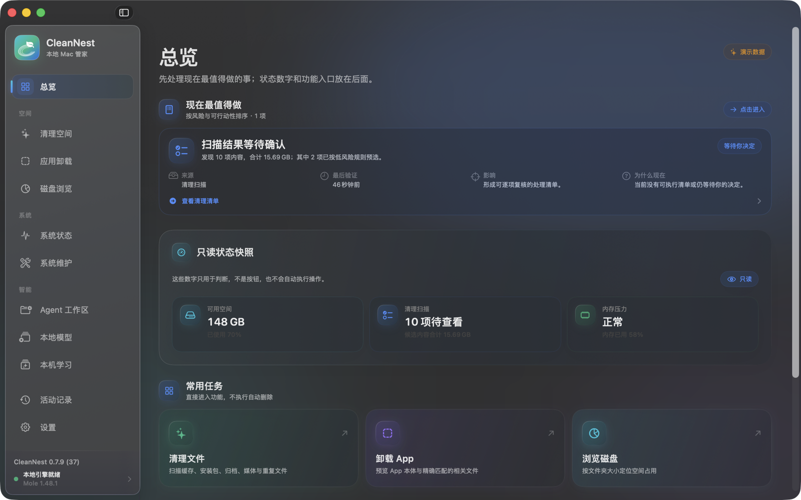
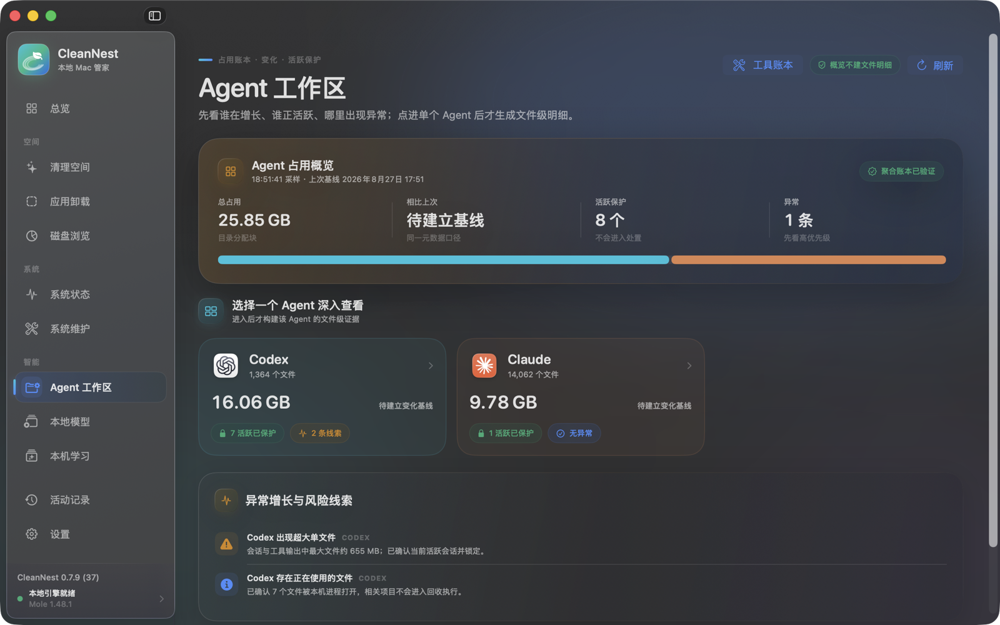
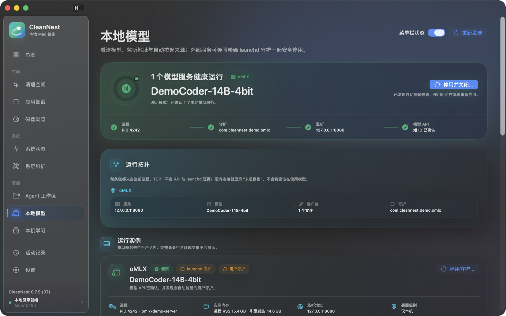
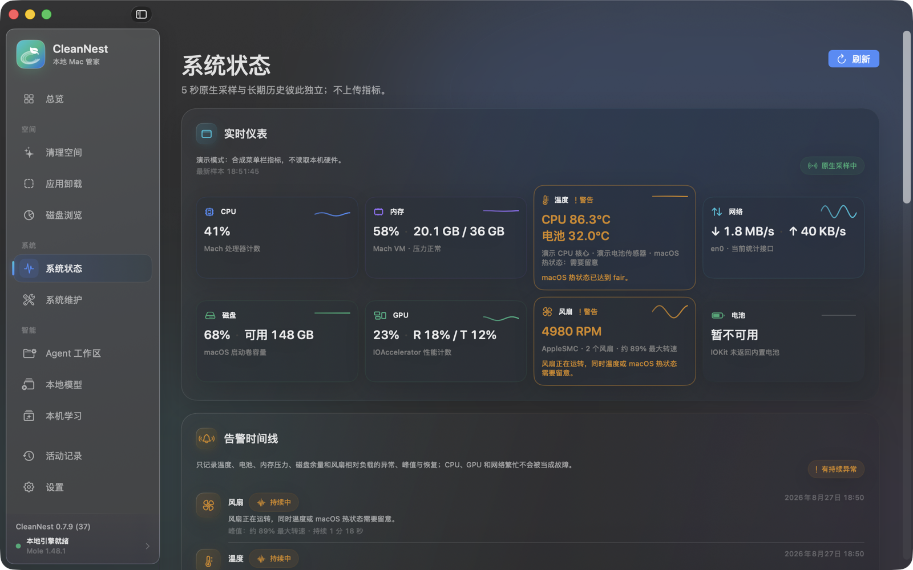
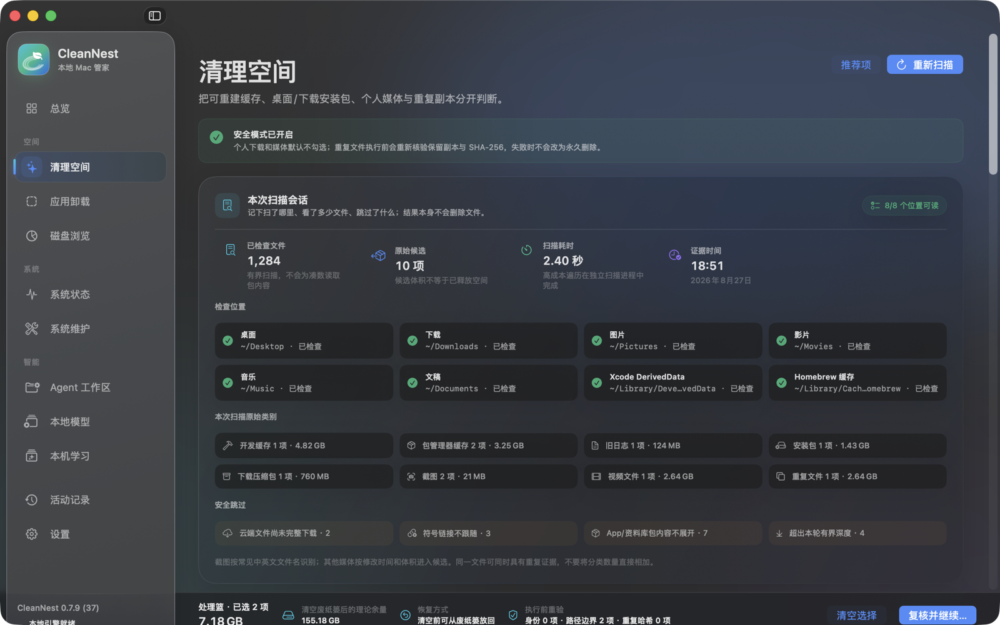

<div align="center">

# CleanNest

**Local Mac management and safe cleanup for AI development workflows.**

CleanNest brings Agent workspaces, local model services, system alerts, and storage evidence into one on-device control surface. See first, understand second, decide last. Files go to the Trash by default, and AI can never authorize deletion.

[简体中文](README.md) · **English** · [繁體中文](README.zh-TW.md) · [日本語](README.ja.md) · [한국어](README.ko.md)

[](https://github.com/n9896027/CleanNest/actions/workflows/ci.yml)
[](https://github.com/n9896027/CleanNest/actions/workflows/codeql.yml)


[](LICENSE)

[Documentation](#documentation) · [Releases](https://github.com/n9896027/CleanNest/releases) · [Report an issue](https://github.com/n9896027/CleanNest/issues) · [Security](SECURITY.md)

</div>

## 0.12.0: cleanup evidence, review, and recovery

The unified version is **0.12.0 (Build 50)**. General cleanup now rechecks active files before execution, exposes path-specific review for blocked items, and records a persistent execution ledger with per-item recovery. APFS, sparse files, model-configuration references, and application containers use separate evidence rather than treating unknown or logical sizes as reclaimable space. An official PKG must still be built from the same clean, checked `main` commit; see [Releases](https://github.com/n9896027/CleanNest/releases) for actual downloads. Read the [0.12.0 roadmap](docs/ROADMAP-0.12.md) and [verification record](docs/VERIFICATION-0.12.0.md) for scope and limits.

### 0.10.1: complete MLX Serve monitoring

Use **⌘K to find a feature**, with Back/Forward navigation and explicit Storage, AI Tools, and System groups. Disk Browser and System Status now use task-based sections; optional explanations and diagnostics expand on demand. Uninstall switches to a list → detail flow in narrow windows. Risk warnings, confirmations, recovery, scans, and model controls remain available. No new third-party dependency is introduced.

This patch adds process, port 11234, OpenAI-compatible API, and launchd-supervisor discovery for `mlx-serve` without changing existing control boundaries. See the [0.10.1 verification record](docs/VERIFICATION-0.10.1.md).

### Retained from 0.9.0: explain system-data storage

Open **Disk Browser → View storage inventory** to inspect 25 curated locations, with measured allocation, ownership, plain-language consequences, search, filters, coverage gaps, and changes between complete in-session scans. Models, backups, and virtual disks are not treated as disposable caches. The direct-UI localization audit covers these explanations in all three app languages.

This independently implemented, read-only inventory is not Apple's private System Data classification or a promise of reclaimable space. It uses the scanner XPC service, caps each location at 100,000 entries, and skips protected paths without confirmed access. System snapshots, system-level runtimes, and custom storage locations are not included. See [0.9.0 verification and limits](docs/VERIFICATION-0.9.0.md). No 0.9.0 release or installer has been published.



<p align="center"><sub>Synthetic demo data · Real local app UI · No user files, real processes, or private model details</sub></p>

CleanNest is not a conventional cleaner with AI copy added on top. It is designed for Macs running Codex, Claude, Pi Agent, local models, and developer tooling: identify who is growing, what is still active, why a service restarts, which signals are abnormal, and what can be handled recoverably.

| Agent Workspace | Local Model Runtime Center | Status and alerts | Safe cleanup |
| --- | --- | --- | --- |
| Usage, change, active protection, anomalies | Platform, short ID, listeners, clients, launchd | CPU, memory, network, GPU, temperature, fans, battery | Preview, identity checks, Trash, recovery records |

> [!IMPORTANT]
> CleanNest can now be built locally as a Universal 2 PKG with Developer ID signing, Apple notarization, and stapled tickets. Check [Releases](https://github.com/n9896027/CleanNest/releases) for actual public downloads. CI ad-hoc artifacts remain verification-only and are not official installers.

## More than a disk cleaner

<table>
  <tr>
    <td width="50%">
      
      <br><strong>Agent Workspace</strong><br>
      <sub>Bounded ledgers for Codex, Claude, Pi Agent, Kimi, WorkBuddy, Hermes, OpenClaw, Trae, and MiniMax Hub. The overview does not build file-level evidence; details are loaded only after you open one Agent.</sub>
    </td>
    <td width="50%">
      
      <br><strong>Local Model Runtime Center</strong><br>
      <sub>Discover oMLX, MLX-LM, MLX Serve, Ollama, LM Studio, and llama.cpp/OpenAI-compatible services, then explain ports, model short IDs, established TCP clients, and automatic restart sources.</sub>
    </td>
  </tr>
  <tr>
    <td width="50%">
      
      <br><strong>On-device status and alerts</strong><br>
      <sub>One threshold policy drives the menu bar, status page, and alert timeline. Warnings use text, symbols, and color without treating an ordinary busy workload as a hardware fault.</sub>
    </td>
    <td width="50%">
      
      <br><strong>Evidence-led safe cleanup</strong><br>
      <sub>Separate rebuildable caches, installers, screenshots, personal media, and full-SHA-256 duplicates. Personal files are not preselected, and identity is revalidated before execution.</sub>
    </td>
  </tr>
</table>

> These screenshots come from the local `CLEANNEST_DEMO=1` runtime. They demonstrate the current UI structure and states; every value, file, process, and model shown is synthetic rather than a user measurement.

## From a problem to reviewable evidence

| The problem | How CleanNest approaches it |
| --- | --- |
| Several coding Agents keep growing, but ownership is unclear | Show per-Agent usage, change, active-file protection, and anomalies; build file evidence only inside one Agent detail view |
| A local model restarts after being stopped | Correlate process, listener, platform API, established clients, and launchd supervisor before offering a control appropriate to the ownership tier |
| Temperature or fan behavior becomes abnormal | Share thresholds across the menu bar, status page, and a bounded local timeline with peak, duration, and recovery evidence |
| Your disk is suddenly full, but the cause is unclear | Reconcile directory, owning-app, and functional views while keeping APFS capacity, classified files, and cleanup candidates separate |
| Rebuildable caches are mixed with downloads and personal data | Separate low-risk generated data from items that require review or should be kept |
| App uninstallers leave files behind | Preview the app and related files matched by its exact Bundle ID |
| You do not want a file inventory sent to a cloud model | Deterministic scans need no AI; optional analysis accepts only an explicit `127.0.0.1` endpoint and a bounded metadata snapshot |

## Core capabilities

- **Storage cleanup** — scan developer caches, logs, installers, and other candidates; select items individually and move them to the macOS Trash.
- **Desktop and mounted installer media** — review DMG, PKG, XIP, ISO, and installer ZIP files from Desktop and Downloads. Mounted installer images expose their source and a separately confirmed safe-eject action; content under `/Volumes` never enters the deletion list.
- **Downloads, screenshots, media, and exact duplicates** — common `ScreenShot`, `Screenshot`, `Screen Shot`, `ScreenCapture`, and Chinese screenshot names enter a dedicated group with one-click select/deselect. Other media still uses age and size gates, while exact duplicates require full SHA-256. Personal files are never preselected, and file identity plus the retained copy are revalidated before execution.
- **Isolated scanner service** — cleanup, disk sizing, and evidence indexing run inside an embedded, independently signed XPC service. Cancellation, interruption, or a scanner crash leaves the UI alive and cannot replace the last complete result with partial state.
- **Agent Workspace** — build bounded ledgers for Codex, Claude, Pi Agent, Kimi, WorkBuddy, Hermes, OpenClaw, Trae, and MiniMax Hub; Xiaoyunque remains explicitly unverified when no reproducible sample exists. Installed Agents use the real icon from their local App bundle; CLI-only or unavailable apps receive a neutral fallback, and CleanNest does not redistribute third-party icons. Version 0.6.4 maps applications, data roots, processes, launchd jobs, ports, and local models, and reports a model link only when an established TCP connection proves it. Backup-first actions remain hard-coded to settled Codex/Claude cache, temporary, and log files; every other Agent, session, private index, memory, credential, and runtime stays read-only.
- **Native developer-tool ledger** — use Git `worktree prune --dry-run`, Docker `system df`, Hugging Face `cache prune --dry-run`, npm's configured cache location, and pip `cache info`. Only Git and Hugging Face expose a confirmed action after a fresh dry run; broad Docker, npm, and pip cleanup stays disabled without an official preview.
- **Incremental disk browser** — stream partial results while scanning; reuse only unchanged metadata signatures for 15 minutes; disclose cache hits, live scans, and a cache-bypassing deep refresh.
- **Cleanup Decision Center** — combine breadcrumb drill-down and a native treemap with deterministic purpose, growth cause, impact, recoverability, confidence, and a safe next action for every item. You can manually mark an item for review, keep it, or decide later without overriding safety boundaries.
- **Live menu-bar monitor** — independently sample CPU, memory, network, disk, GPU, temperature, fans, and battery at a selectable 1/2/5/10-second interval. A State-style two-line value/abbreviation layout is the compact default; expanded text, mini graphs, ordering, and per-item visibility remain configurable. Warning and critical states use both color and `!` / `!!`, combining macOS thermal state with pressure signals instead of treating ordinary high workload as a fault.
- **Local Model Runtime Center** — organize platform, service, model short ID, established TCP clients, and launchd supervisors into an evidence topology, with explicit diagnostics for port conflicts, model replacement, and automatic restarts. CleanNest-owned processes, current-user processes, user LaunchAgents, and system/other-user services use four distinct control tiers; every controllable action revalidates identity, and supervisor configuration remains recoverable.
- **System status** — combine the native live instrument panel with battery and health information, 60-second local history, and plain-language memory-pressure and process guidance.
- **Process management** — request a normal process quit only after identity checks, system-process protection, and user confirmation; CleanNest does not automatically force-quit it.
- **App uninstall** — browse installed apps and preview the app bundle plus related files matched by exact Bundle ID.
- **System maintenance** — run selected low-risk maintenance tasks and keep their results in one activity history.
- **Auditable local learning** — file proposals are clustered by type, location level, risk, and age. Clusters support batch review, seven-day trials, pause, revoke, expiry cleanup, and measured impact on the current list; they never select or delete files.
- **Model Workbench** — run a minimal streaming request that contains no scan metadata, then see loopback health latency, time to first output, total time, the exact API model ID, and memory-headroom guidance.
- **Data controls** — export or clear the activity log independently; restoring safe defaults resets preferences without silently erasing activity, learning rules, disk indexes, metric history, or macOS permissions.
- **Built-in native engine** — cleanup, disk, system data, Agent, and system status work without Homebrew or any additional cleanup engine.
- **Update checks** — manually query the latest official GitHub Release from the app menu or About page; CleanNest only compares versions and opens a validated repository page, never silently downloading or installing.
- **Native macOS experience** — SwiftUI/AppKit interface, light and dark appearance, permission recovery guidance, activity history, and a safe demo mode.
- **Read-only MCP** — expose bounded, redacted local evidence to a trusted AI client over bundled stdio only; no HTTP listener, deletion, process control, or settings tools.
- **Three-language resources** — a String Catalog provides English, Simplified Chinese, and Traditional Chinese for core navigation and primary screens.

## Download and run

If [Releases](https://github.com/n9896027/CleanNest/releases) contains an official PKG, install it into `/Applications` without Xcode or Terminal. Check the version, SHA-256, and known limitations listed with the release. If no public PKG is available, build from source using the steps below.

Requirements:

- macOS 14 Sonoma or later
- Xcode Command Line Tools, only when building from source
- Apple Silicon and `mlx-lm`, only for optional local AI

Build from source:

```bash
git clone https://github.com/n9896027/CleanNest.git
cd CleanNest
./build.sh
open build/CleanNest.app
```

After the one-time source build, regular scanning, analysis, cleanup, and maintenance are available in the graphical app without installing an additional engine.

Official distribution uses Developer ID Application / Installer signing, Apple notarization, and stapled tickets. Maintainers can build a Universal 2 PKG with `scripts/build-installer.sh`. CI ad-hoc artifacts remain verification-only. After upgrading from an old self-signed copy, reauthorize the current `/Applications/CleanNest.app` if macOS reports stale privacy permissions. Do not trust third-party downloads claiming otherwise.

## Optional, replaceable on-device MLX model

CleanNest can connect to a local `mlx_lm.server` to add purpose explanations, risk notes, and a suggested review order to cleanup candidates and disk directories. The model is an explanation layer, not the cleanup engine. Deterministic scans still work without AI, and an AI failure does not change existing results.

Privacy and execution boundaries:

- Only an explicit `http://127.0.0.1:<port>/v1` endpoint is accepted; LAN and public model endpoints are rejected.
- Requests contain limited metadata such as type, size, age, one-time tokens, and redacted path hints—not file contents.
- Disk explanations use a bounded sample of direct child items rather than the full directory tree.
- The Swift client strictly validates fields, enums, response size, and item identity.
- AI cannot expand a scan, select an item, quit a process, run a command, or delete a file.
- Local learning stores only the item category, normalized display name, a one-way path fingerprint, successful-cleanup count, and model feedback. It excludes full candidate paths and file contents, and can be reviewed or cleared in the app.

In **Settings (`设置`) → Local AI Analysis (`本机 AI 分析`)**, CleanNest can reuse an existing loopback service such as oMLX or launch the selected `mlx_lm.server`. It reads the exact API model ID from `/v1/models` and keeps that short name separate from the local folder used for self-launch, so a filesystem path is never sent to oMLX as `model`. Common folders, including `~/.omlx/models`, are scanned with strict bounds. CleanNest never downloads a large model automatically, changes DFlash settings, or accepts model terms on your behalf.

## Safety model

- System roots, `/System`, `/Library`, the home directory itself, and an allowed root itself cannot become cleanup targets.
- Native cleanup accepts only validated descendant paths and rejects symbolic links.
- Files go to the macOS Trash by default; CleanNest does not use an irreversible `rm -rf` cleanup path.
- App removal revalidates the path, device, file identity, and Bundle ID. It uses an atomic Trash move when the current account truly has directory permission, and asks Finder to present native macOS administrator authentication only when required. Related files remain untouched unless the app bundle is confirmed in Trash.
- High-risk interactive commands are never auto-confirmed through simulated keyboard input.
- The scanner service has no deletion, process-control, or network capability. If it is unavailable, the app fails explicitly instead of silently falling back to an in-process scan.
- Pull requests run core tests, a complete app-bundle build, architecture checks, dependency review, and CodeQL.
- GitHub Actions use least-privilege permissions and immutable Action references; Dependabot checks dependency and Action updates.

See [SECURITY.md](SECURITY.md) for the disclosure scope and private reporting route.

## Documentation

Detailed maintainer documentation is currently written primarily in Simplified Chinese:

| Document | What it covers |
| --- | --- |
| [Permissions](docs/PERMISSIONS.md) | Full Disk Access, folder authorization, and why code identity affects macOS permissions |
| [Local AI](docs/LOCAL_AI.md) | MLX model discovery, switching, transmitted metadata, and safety boundaries |
| [Metric history](docs/METRICS.md) | 60-second sampling, SQLite WAL, retention, and field boundaries |
| [Read-only MCP](docs/MCP.md) | Local stdio configuration, seven tools, and the read-only trust boundary |
| [Threat model](docs/THREAT_MODEL.md) | Protected assets, attack surfaces, controls, and exclusions |
| [Troubleshooting](docs/TROUBLESHOOTING.md) | Built-in engine, permissions, AI, build, process, and battery-status issues |
| [Architecture](docs/ARCHITECTURE.md) | Modules, data flow, and dangerous-operation boundaries |
| [Agent Workspace](docs/AGENT_WORKSPACE.md) | Multi-Agent ledgers, runtime evidence, signed rules, backup-first actions, and recovery boundaries |
| [Privacy](PRIVACY.md) | Local data, network access, retention, and removal |
| [Roadmap](ROADMAP.md) | Completed work, near-term priorities, and explicit non-commitments |
| [0.6.3 verification report](docs/VERIFICATION-0.6.3.md) | Agent decisions, verified backups, conflict-safe restore, native-tool boundaries, and local build evidence |
| [0.6.5 verification report](docs/VERIFICATION-0.6.5.md) | Sealed version, full-section audit, multi-Agent boundaries, tests, and local build evidence |
| [0.7.0 verification report](docs/VERIFICATION-0.7.0.md) | Cold start, page lifecycle, measured memory gates, lazy lists, and accessibility evidence |
| [0.7.1 verification report](docs/VERIFICATION-0.7.1.md) | Task-first overview, segmented settings, activity traceability, independent totals, and memory gates |
| [0.7.2 verification report](docs/VERIFICATION-0.7.2.md) | Scan sessions, processing basket, media/duplicate review, three separate space facts, and startup-volume default |
| [0.7.3 verification report](docs/VERIFICATION-0.7.3.md) | App dependency graph, per-item choices, six-stage fail-closed uninstall flow, and returned recovery locations |
| [0.7.4 verification report](docs/VERIFICATION-0.7.4.md) | APFS ledger, classified-file coverage, reliable growth comparison, and live 314/868/126 reconciliation |
| [0.7.5 verification report](docs/VERIFICATION-0.7.5.md) | Shared alert thresholds, local alert timeline, menu-width budget, app-level process grouping, and high-frequency update isolation |
| [0.7.6 verification report](docs/VERIFICATION-0.7.6.md) | Read-only maintenance preflight, impact confirmation, before/after evidence, recovery checks, and honest uncertainty |
| [0.7.7 verification report](docs/VERIFICATION-0.7.7.md) | Local-model evidence topology, live clients, four control tiers, runtime diagnostics, and a bounded Ollama lifecycle check |
| [0.7.8 verification report](docs/VERIFICATION-0.7.8.md) | Agent overview/detail lazy loading, clustered learning rules, trials, measured sorting impact, and a 10,000-history projection test |
| [0.7.9 source-release verification](docs/VERIFICATION-0.7.9.md) | 0.6.5 migration/rollback, cancellation storm, trilingual audit, the real 48-hour gate, SBOM, and provenance |
| [0.8.0 verification report](docs/VERIFICATION-0.8.0.md) | Tiered agent-workspace cleanup: installer-leftover detection, 30/60-day session and backup settle gates, and whole-group stale VM review |
| [0.8.1 verification report](docs/VERIFICATION-0.8.1.md) | Defect fixes: stuck scan state, restore-retry deadlock, stderr pipe deadlock, XPC connection teardown, duplicate-key crashes, and a single version source |
| [0.8.2 verification report](docs/VERIFICATION-0.8.2.md) | Usability: plain-language disposition labels with technical terms on hover, and a sidebar trimmed to six everyday entries with a collapsible advanced group |
| [0.8.3 verification report](docs/VERIFICATION-0.8.3.md) | The learning page becomes Cleanup Habits: bureaucratic terms removed, enable button and flow diagram rewritten in plain language |
| [0.8.4 verification report](docs/VERIFICATION-0.8.4.md) | Overview restructure: single hero action card, compact secondary rows, visual status tiles; audit columns and defensive disclaimers removed |
| [0.11.0 candidate verification](docs/VERIFICATION-0.11.0.md) | Historical automated evidence and manual UI, installation, upgrade, model-platform, and real 48-hour boundaries |
| [0.12.0 verification record](docs/VERIFICATION-0.12.0.md) | Active-file checks, path review, execution ledger, recovery, APFS, sparse files, and release boundaries |
| [0.7 migration and rollback](docs/MIGRATION-0.7.md) | Honest compatibility boundaries for settings, metrics, activity, indexes, learning rules, and Agent recovery records |
| [Localization status](docs/LOCALIZATION-STATUS.md) | Three-language Catalog, format placeholders, strict source audit, and pending manual acceptance |
| [0.7 series roadmap](docs/ROADMAP-0.7.md) | Product, architecture, acceptance gates, and explicit non-goals for 0.7.0–0.7.9 |
| [0.6.5 section audit](docs/AUDIT-0.6.5.md) | Current behavior, gaps, performance, and accessibility evidence for every primary surface |
| [0.6.0 verification report](docs/VERIFICATION-0.6.0.md) | XPC isolation, cancellation rollback, injected scanner failure, recovery, and cold-start memory evidence |
| [0.5.5 verification report](docs/VERIFICATION-0.5.5.md) | Scan peak memory, adaptive background work, staged duplicate proof, and cancellation behavior |
| [0.5.4 verification report](docs/VERIFICATION-0.5.4.md) | Downloads, media, exact duplicate detection, and personal-file safety boundaries |
| [0.5.3 verification report](docs/VERIFICATION-0.5.3.md) | Local-model runtime discovery, launchd controls, menu-bar metrics, activity statistics, and remaining real-device gates |
| [0.5.2 verification report](docs/VERIFICATION-0.5.2.md) | Compact menu-bar monitoring, login-item behavior, and current-Mac evidence |
| [0.5.0 verification report](docs/VERIFICATION-0.5.0.md) | Local tests, large-directory incremental scan evidence, and gates that remain closed |
| [Maintainer operations](docs/OPERATIONS.md) | Change control, CI failures, credentials, releases, and security incidents |
| [Changelog](CHANGELOG.md) | Released and unreleased changes |
| [Contributing](CONTRIBUTING.md) | Development, testing, pull requests, and safety requirements |

## Built-in native engine

Cleanup, disk, system data, Agent, and system status all use native components installed with CleanNest. The app does not detect, invoke, or install an external cleanup engine. Homebrew remains only a developer-cache scan target, not a runtime dependency.

CleanNest's source code is available under the [MIT License](LICENSE). See [third-party notices](THIRD_PARTY_NOTICES.md) for optional local models and reference implementations.

## Development and verification

Run the app during development:

```bash
swift run CleanNest
```

Run the deterministic unit and integration checks:

```bash
swift test
swift run CleanNestSelfTest
```

Preview the UI with synthetic data only:

```bash
CLEANNEST_DEMO=1 swift run CleanNest
```

The current version is **0.12.0 (Build 50)**, focused on cleanup evidence, path-specific review, execution ledgers, recovery, and trusted distribution. An official PKG must be built from the same clean, checked `main` commit; actual public downloads remain subject to the Releases page. The real 48-hour soak, complete manual trilingual UI acceptance, Intel hardware, macOS 14, and clean-machine installation of 0.12.0 require separate evidence and cannot be inferred from CI compilation or notarization of an older build. Reproducible bug reports and feature proposals are welcome in [Issues](https://github.com/n9896027/CleanNest/issues); report security vulnerabilities privately.

The English, Simplified Chinese, and Traditional Chinese String Catalogs, format placeholders, and strict direct-UI source audit now pass. This is not a substitute for manual acceptance: narrow windows, long copy, keyboard navigation, and VoiceOver still require separate evidence. Japanese and Korean currently provide project overviews, not complete app UI resources.
