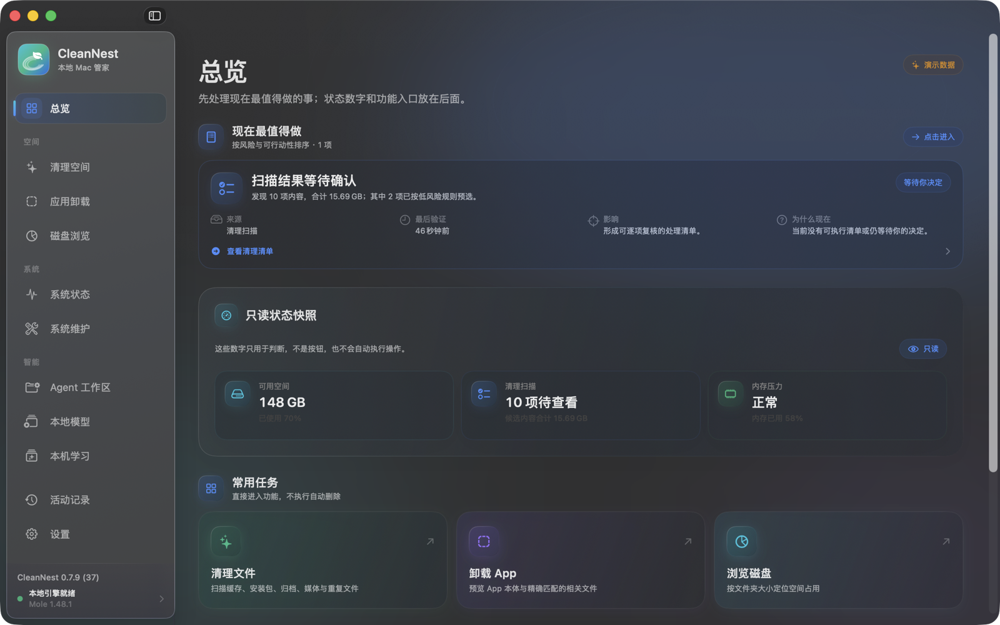
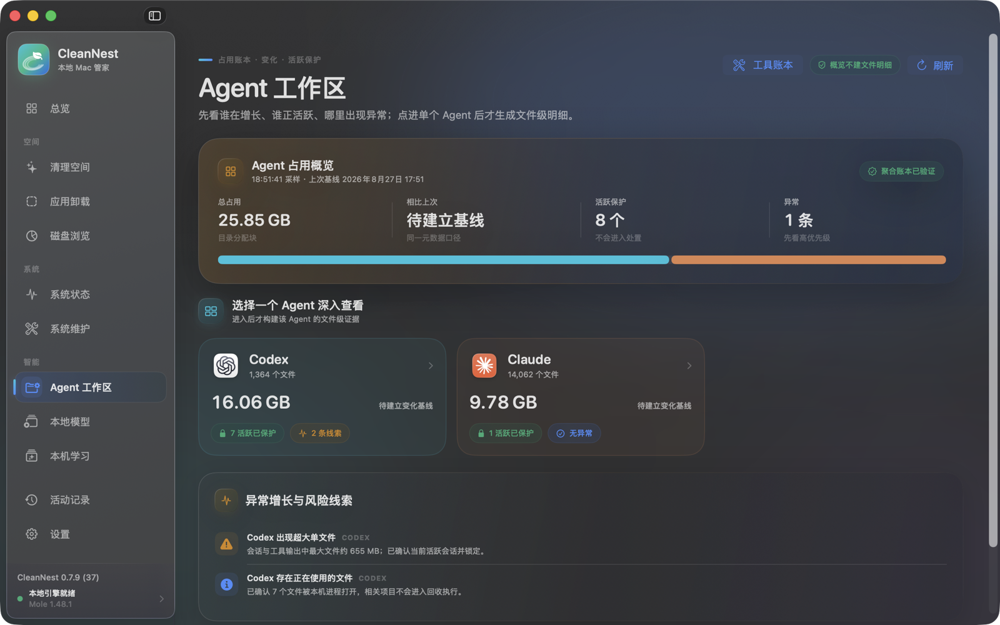
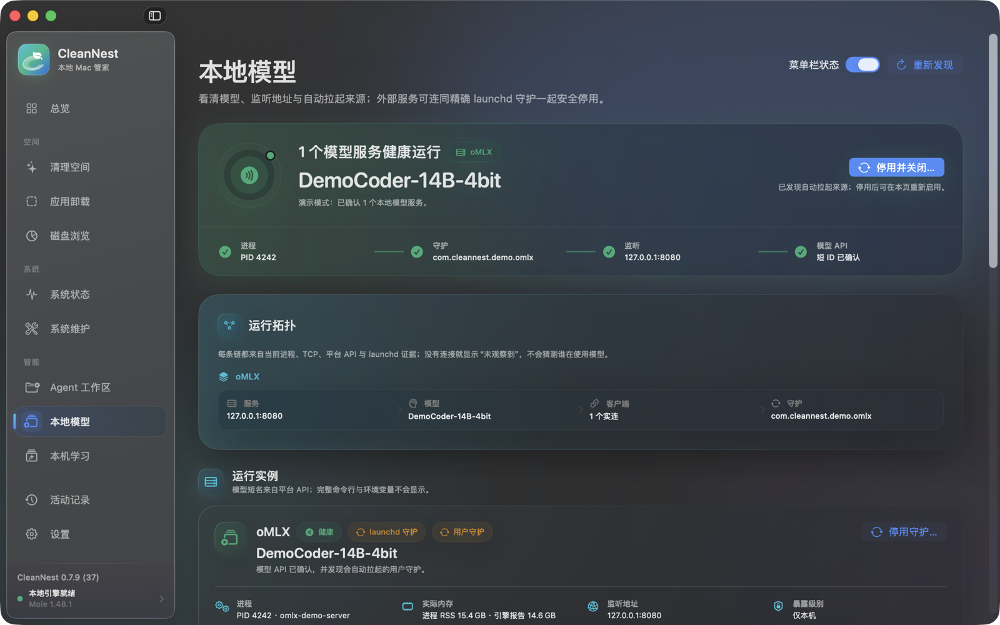
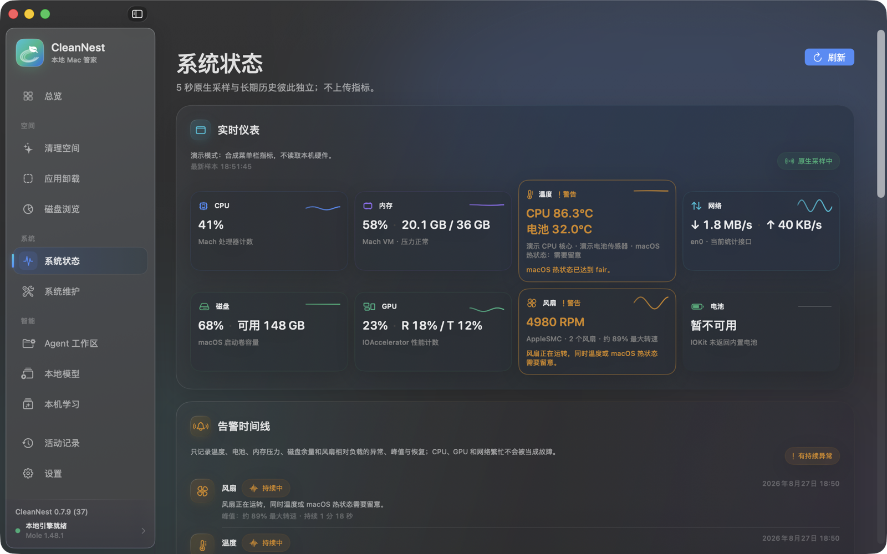
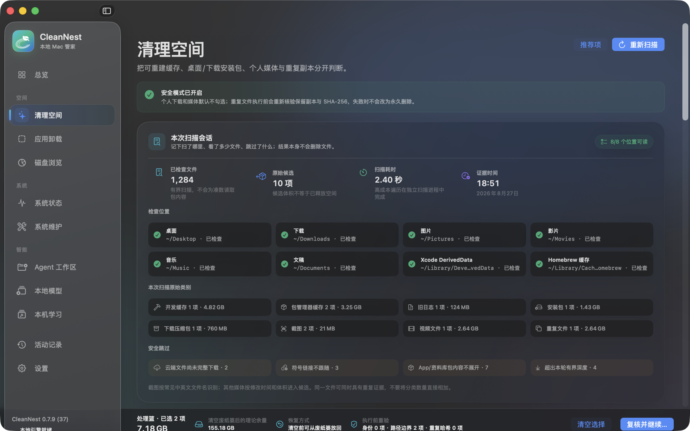

<div align="center">

# CleanNest

**AI 開発ワークフローのための、ローカル Mac 管理と安全なクリーンアップ。**

Agent ワークスペース、ローカルモデルサービス、システム警告、ストレージの根拠を 1 つのオンデバイス画面にまとめます。まず確認し、次に理解し、最後に自分で決定します。ファイルは既定でゴミ箱へ移動し、AI が削除を承認することはありません。

[简体中文](README.md) · [English](README.en.md) · [繁體中文](README.zh-TW.md) · **日本語** · [한국어](README.ko.md)

[](https://github.com/n9896027/CleanNest/actions/workflows/ci.yml)
[](https://github.com/n9896027/CleanNest/actions/workflows/codeql.yml)


[](LICENSE)

[ドキュメント](#ドキュメント) · [リリース](https://github.com/n9896027/CleanNest/releases) · [問題を報告](https://github.com/n9896027/CleanNest/issues) · [セキュリティ](SECURITY.md)

</div>



<p align="center"><sub>合成デモデータ · 実際のローカル App UI · ユーザーファイル、実プロセス、非公開モデル情報は含みません</sub></p>

CleanNest は、従来のクリーナーに AI の説明文を重ねただけの製品ではありません。Codex、Claude、Pi Agent、ローカルモデル、開発ツールを同時に使う Mac で、何が増えているか、何が動作中か、なぜサービスが再起動するか、どの信号が異常か、何を復元可能な方法で処理できるかを明らかにします。

| Agent ワークスペース | ローカルモデル実行センター | 状態と警告 | 安全なクリーンアップ |
| --- | --- | --- | --- |
| 使用量、変化、稼働中保護、異常 | プラットフォーム、短縮 ID、待受、クライアント、launchd | CPU、メモリ、ネットワーク、GPU、温度、ファン、バッテリー | プレビュー、同一性確認、ゴミ箱、復元履歴 |

> [!IMPORTANT]
> CleanNest は現在、Developer ID 署名、Apple 公証、チケットのステープルを備えた Universal 2 PKG をローカルで構築できます。実際の公開ダウンロードは [Releases](https://github.com/n9896027/CleanNest/releases) を確認してください。CI の ad-hoc 成果物は検証専用であり、正式なインストーラではありません。

## ディスククリーナーだけではありません

<table>
  <tr>
    <td width="50%">
      
      <br><strong>Agent ワークスペース</strong><br>
      <sub>Codex、Claude、Pi Agent、Kimi、WorkBuddy、Hermes、OpenClaw、Trae、MiniMax Hub を有界台帳で把握します。ファイル単位の根拠は、1 つの Agent 詳細を開いたときだけ構築します。</sub>
    </td>
    <td width="50%">
      
      <br><strong>ローカルモデル実行センター</strong><br>
      <sub>oMLX、MLX-LM、MLX Serve、Ollama、LM Studio、llama.cpp/OpenAI-compatible サービスを検出し、ポート、モデル短縮 ID、TCP クライアント、自動再起動元を説明します。</sub>
    </td>
  </tr>
  <tr>
    <td width="50%">
      
      <br><strong>オンデバイス状態と警告</strong><br>
      <sub>同じしきい値ポリシーをメニューバー、状態画面、警告履歴で共有します。通常の高負荷を故障と決めつけず、文字・記号・色で異常を示します。</sub>
    </td>
    <td width="50%">
      
      <br><strong>根拠を先に示す安全なクリーンアップ</strong><br>
      <sub>再生成可能なキャッシュ、インストーラ、スクリーンショット、個人メディア、完全 SHA-256 一致の重複を分離します。個人ファイルは事前選択せず、実行前に同一性を再確認します。</sub>
    </td>
  </tr>
</table>

> 画面はローカルの `CLEANNEST_DEMO=1` 実行環境から取得しました。現在の UI 構造と状態表現を示すもので、数値、ファイル、プロセス、モデルはすべて合成デモデータです。

## 問題から確認可能な根拠へ

| 困っていること | CleanNest のアプローチ |
| --- | --- |
| 複数のコーディング Agent が増え続け、所有者が分からない | Agent ごとの使用量、変化、稼働中ファイル保護、異常を表示し、ファイル根拠は単体詳細内だけで構築 |
| 停止したローカルモデルが再起動する | プロセス、待受、プラットフォーム API、確立済みクライアント、launchd 監視ジョブを関連付け、所有権に応じた制御を提示 |
| 温度やファン動作が異常になる | メニューバー、状態画面、有界ローカル履歴でしきい値を共有し、ピーク、継続時間、回復の根拠を表示 |
| ディスクが急に一杯になったが、原因が分からない | ディレクトリ、所有アプリ、機能分類の 3 視点を照合し、APFS 容量、分類済みファイル、整理候補を分離 |
| 再生成可能なキャッシュとダウンロード、個人データが混在している | 低リスクの生成データ、要確認項目、保持すべき内容を区別 |
| アプリ削除後の残存ファイルが心配 | アプリ本体と、正確な Bundle ID で一致した関連ファイルを事前表示 |
| ファイル一覧をクラウドモデルへ送りたくない | 決定論的スキャンは AI 不要。任意解析は明示した `127.0.0.1` と有界メタデータだけを受け付ける |

## 主な機能

- **ストレージ整理**：開発用キャッシュ、ログ、インストーラなどの候補を検出し、個別に選んで macOS のゴミ箱へ移動します。
- **デスクトップとマウント済みインストールメディア**：デスクトップ／ダウンロード内の DMG、PKG、XIP、ISO、インストーラ ZIP を確認候補に追加します。マウント済みイメージは元ファイルと安全な取り出し操作を別表示し、`/Volumes` 内の内容を削除候補にはしません。
- **独立スキャナ分離**：整理スキャン、ディスク容量計測、証拠インデックスは、アプリ内の独立署名 XPC サービスで実行します。キャンセル、通信中断、スキャナ障害が発生しても UI は維持され、未完了結果で前回の完全な結果を上書きしません。
- **Agent ワークスペース**：Codex、Claude、Pi Agent、Kimi、WorkBuddy、Hermes、OpenClaw、Trae、MiniMax Hub を有界ルールで可視化し、再現可能なサンプルがない小雲雀は未検証のまま扱います。インストール済み Agent はローカル App Bundle の実アイコンを使用し、CLI 専用または未インストールの場合は中立アイコンにフォールバックします。CleanNest は第三者のアイコンを再配布しません。0.6.4 はアプリ、データ、プロセス、launchd、ポート、ローカルモデルの証拠関係を表示し、確立済み TCP 接続がある場合だけモデル接続を示します。バックアップ優先の処理権限は Codex/Claude の静止キャッシュ・一時ファイル・ログに固定され、その他は読み取り専用です。
- **ダウンロード、スクリーンショット、メディア、完全一致の重複**：`ScreenShot`、`Screenshot`、`Screen Shot`、`ScreenCapture` などの一般的な名前は専用グループへ直接分類し、グループ単位で一括選択・解除できます。その他のメディアには従来のサイズ・経過日数条件を適用し、重複は完全な SHA-256 で確認します。個人ファイルは自動選択しません。
- **増分ディスクブラウザ**：スキャン中も部分結果を表示し、15 分以内はメタデータ署名が変わらない項目だけを再利用します。キャッシュ命中、実スキャン、完全再計算を明示します。
- **整理判断センター**：Treemap とパンくずに加え、用途、増加理由、影響、復元性、根拠の強さ、安全な次の操作を項目ごとに示します。安全境界を上書きせず、確認待ち・保持・後で判断を手動で指定できます。
- **メニューバーモニタ**：CPU、メモリ、ネットワーク、ディスク、GPU、温度、ファン、バッテリーを 1/2/5/10 秒間隔で取得します。State 風の 2 段短縮表示が既定で、順序や表示方式も変更できます。注意／重大状態は橙／赤と `!`／`!!` を併用し、macOS の熱状態と実際の圧力信号を基に、通常の高負荷を障害として誤表示しません。
- **ローカルモデル実行センター**：プロセス、待受ポート、プラットフォーム API、launchd 監視ジョブを照合し、モデル ID、PID、メモリ、公開状態、`KeepAlive`／ログイン起動の根拠を表示します。確認後は外部サービスと対応するユーザー監視ジョブを一緒に無効化して終了でき、設定は再有効化用に残ります。
- **システム状態**：CPU、メモリ、ディスク、バッテリー、温度、健康状態を表示し、60 秒ごとの履歴をローカルに保存します。
- **プロセス管理**：プロセスの同一性、システム保護、ユーザー確認を経て通常終了を要求します。自動で強制終了はしません。
- **アプリのアンインストール**：インストール済みアプリと、正確な Bundle ID に一致する関連ファイルをプレビューします。
- **システムメンテナンス**：選択した低リスクの保守タスクを実行し、結果を操作履歴にまとめます。
- **監査可能なローカル学習**：明示的な選択や整理成功は、まずレビュー待ちのルール案になります。有効化後も一時停止、再開、削除が可能です。
- **モデルワークベンチ**：ファイル情報を含まない最小リクエストで、ヘルス遅延、初回出力、総時間、実際の API モデル短縮名、メモリ余裕を確認します。
- **データ管理**：操作履歴は JSON 出力または個別消去が可能です。安全な既定値への復元は、学習、索引、履歴指標、macOS 権限を勝手に消しません。
- **内蔵ネイティブエンジン**：整理、ディスク、システムデータ、Agent、システム状態のいずれも Homebrew や追加の整理エンジンを必要としません。
- **アップデート確認**：アプリメニューまたは「このアプリについて」から GitHub の最新正式 Release を手動確認します。バージョン比較と検証済みリポジトリページの表示だけを行い、自動ダウンロードや自動インストールはしません。
- **macOS ネイティブ体験**：SwiftUI/AppKit、ライト/ダーク表示、権限復旧ガイド、操作履歴、安全なデモモードを備えます。
- **読み取り専用 MCP**：同梱の stdio プロセスから、上限付き・匿名化済みのローカル根拠を提供します。HTTP、削除、プロセス制御、設定変更ツールはありません。
- **3 言語リソース**：主要ナビゲーションと中心画面を English、簡体字中国語、繁体字中国語の String Catalog で提供します。

## ダウンロードと実行

必要環境：

- macOS 14 Sonoma 以降
- Xcode Command Line Tools（ソースからのビルド時のみ）
- Apple Silicon と `mlx-lm`（任意のローカル AI 機能のみ）

ソースからビルド：

```bash
git clone https://github.com/n9896027/CleanNest.git
cd CleanNest
./build.sh
open build/CleanNest.app
```

一度ソースからビルドした後は、通常のスキャン、解析、整理、メンテナンスを追加エンジンなしで GUI から実行できます。

正式 PKG は Developer ID Application / Installer 署名、Apple 公証、チケットのステープルを使用し、保守者は `scripts/build-installer.sh` で Universal 2 PKG を構築できます。公開ダウンロードは Releases で確認し、バージョン、SHA-256、既知の制限を照合してください。CI の ad-hoc 成果物は検証専用です。古い自己署名コピーからのアップグレード後に権限が無効になった場合は、現在の `/Applications/CleanNest.app` を再認可してください。

## 交換可能なオンデバイス MLX モデル（任意）

CleanNest はローカルの `mlx_lm.server` に接続し、整理候補やディスクディレクトリに用途説明、リスク注記、確認順序を追加できます。モデルは説明レイヤーであり、整理エンジンではありません。AI を無効にしても、決定論的なスキャンと安全ルールは動作します。

プライバシーと実行上の境界：

- 明示的な `http://127.0.0.1:<ポート>/v1` だけを許可し、LAN や公開モデルのエンドポイントは拒否します。
- リクエストには種類、サイズ、経過時間、一時 token、匿名化したパスのヒントなど、制限されたメタデータだけを含めます。ファイル本文は含みません。
- ディスク説明には、完全なディレクトリツリーではなく、直下項目の限られたサンプルを使用します。
- Swift クライアントがフィールド、列挙値、応答サイズ、項目 ID を厳密に検証します。
- AI はスキャン範囲の拡大、項目選択、プロセス終了、コマンド実行、ファイル削除を行えません。

「设置 → 本机 AI 分析」では、oMLX など既存のループバックサービスを再利用するか、選択した `mlx_lm.server` を起動できます。CleanNest は `/v1/models` から実際の API モデル短縮名を読み取り、自己起動用のローカルディレクトリとは別に管理するため、ファイルパスを oMLX の `model` として送信しません。`~/.omlx/models` も範囲を限定して検索します。大型モデルの自動ダウンロード、DFlash 設定の変更、モデル利用規約への代理同意は行いません。

## 安全設計

- `/System`、`/Library`、ホームディレクトリ自体、システムルート、許可範囲のルート自体は整理対象になりません。
- ネイティブ整理は検証済みの子孫パスだけを受け入れ、シンボリックリンクを拒否します。
- ファイルは既定で macOS のゴミ箱へ移動し、不可逆な `rm -rf` 整理は使用しません。
- システムレベルのアプリ削除に管理者権限が必要な場合、現バージョンは制限を明示し、権限を回避しません。
- 高リスクな対話コマンドを、キーボード入力の模擬で自動承認しません。
- Pull Request ごとにコアテスト、完全な App Bundle ビルド、アーキテクチャ確認、依存関係レビュー、CodeQL を実行します。
- GitHub Actions は最小権限と不変の Action 参照を使い、Dependabot が依存関係と Action の更新を確認します。

開示範囲と非公開の報告方法は [SECURITY.md](SECURITY.md) を参照してください。

## ドキュメント

詳細なメンテナ向け文書は、現在主に簡体字中国語で記載されています。

| 文書 | 内容 |
| --- | --- |
| [権限](docs/PERMISSIONS.md) | フルディスクアクセス、フォルダ認可、コード ID と macOS 権限の関係 |
| [ローカル AI](docs/LOCAL_AI.md) | MLX モデルの選択・切替、送信メタデータ、安全境界 |
| [トラブルシューティング](docs/TROUBLESHOOTING.md) | 内蔵エンジン、権限、AI、ビルド、プロセス、バッテリー状態の問題 |
| [アーキテクチャ](docs/ARCHITECTURE.md) | モジュール、データフロー、高リスク操作の境界 |
| [プライバシー](PRIVACY.md) | ローカルデータ、ネットワーク接続、保存、削除 |
| [ロードマップ](ROADMAP.md) | 完了済み項目、直近の優先事項、明示的な非目標 |
| [変更履歴](CHANGELOG.md) | リリース済み・未リリースの変更 |
| [コントリビューション](CONTRIBUTING.md) | 開発、テスト、Pull Request、安全要件 |

## 内蔵ネイティブエンジン

整理、ディスク、システムデータ、Agent、システム状態はすべて CleanNest と共にインストールされるネイティブコンポーネントで動作します。外部の整理エンジンの検出、呼び出し、インストールは行いません。Homebrew は開発キャッシュのスキャン対象にとどまり、実行依存ではありません。

CleanNest 自体のソースコードは [MIT License](LICENSE) です。MLX とユーザーが選択するモデルについては[サードパーティー通知](THIRD_PARTY_NOTICES.md)を参照してください。

## 開発と検証

```bash
swift run CleanNest
swift test
swift run CleanNestSelfTest
```

実データに触れずデモデータで UI を確認：

```bash
CLEANNEST_DEMO=1 swift run CleanNest
```

現在のバージョンは **0.12.0（Build 50）** で、実行前のアクティブファイル確認、パスごとのレビュー、実行台帳、項目単位の復元、信頼できる配布に重点を置いています。正式 PKG はチェックを通過したクリーンな `main` コミットから構築する必要があり、実際の公開ダウンロードは Releases を確認してください。実時間 48 時間テスト、完全な 3 言語の手動 UI 検収、Intel 実機、0.12.0 のクリーンな Mac へのインストールには個別の証拠が必要であり、CI ビルドや旧版の公証で代替できません。再現可能な不具合や機能提案は [Issues](https://github.com/n9896027/CleanNest/issues) へ、セキュリティ脆弱性は非公開で報告してください。

アプリ UI と詳細なメンテナ向け文書は現在、主に簡体字中国語です。この日本語 README はプロジェクトの範囲を正確に説明するものであり、UI の完全な日本語化を意味しません。
