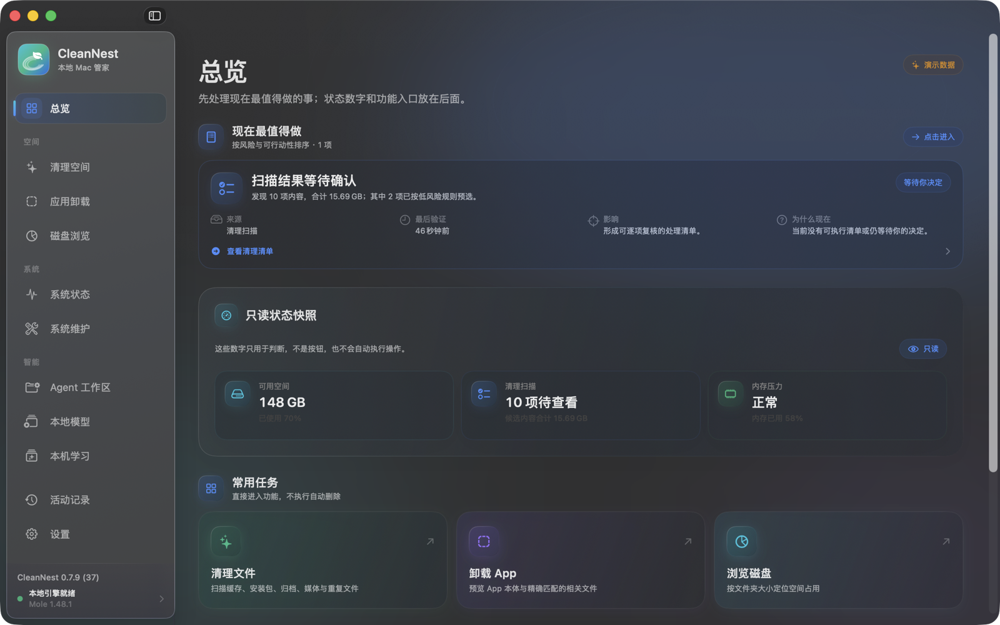
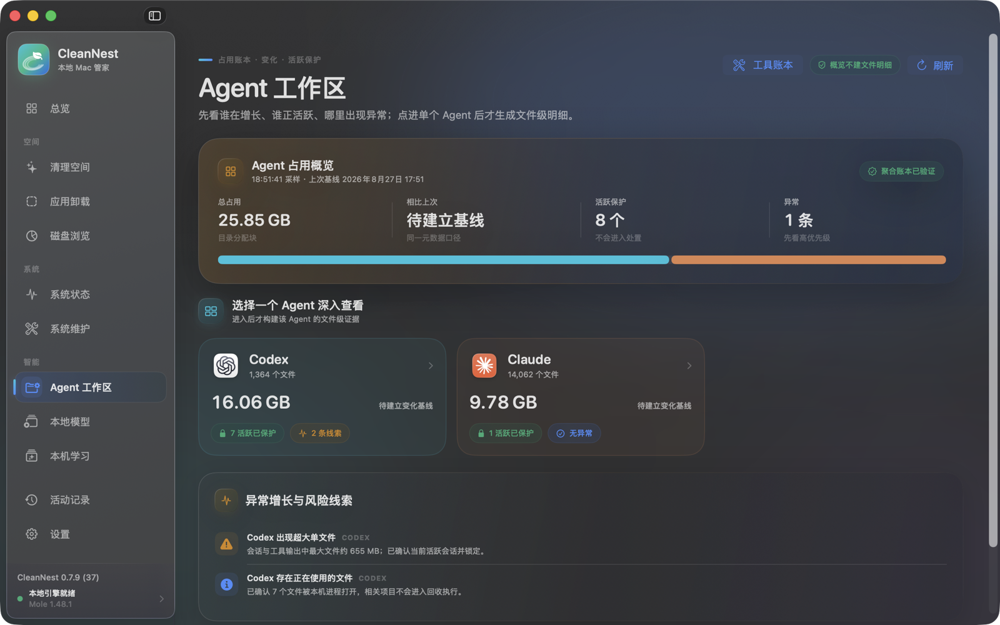
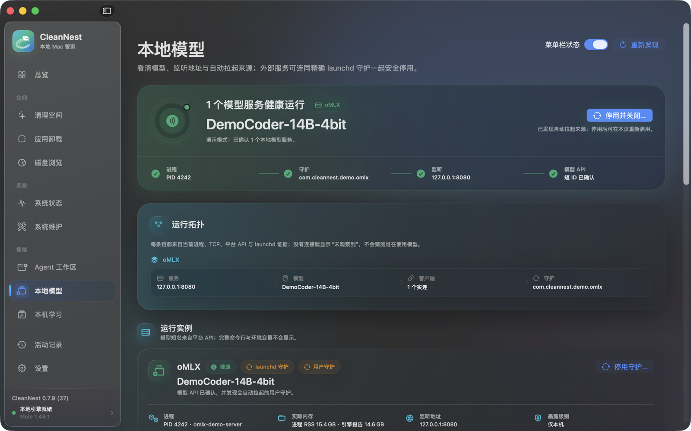
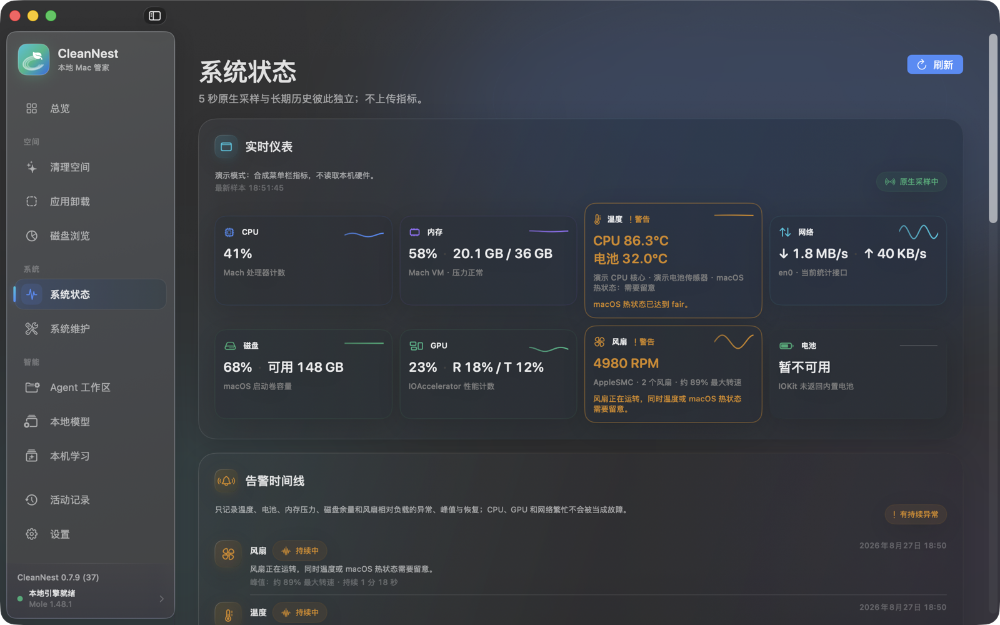
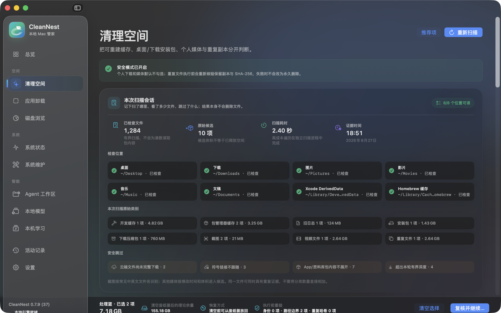

<div align="center">

# CleanNest

**AI 개발 워크플로를 위한 로컬 Mac 관리와 안전한 정리.**

Agent 작업 공간, 로컬 모델 서비스, 시스템 경고와 저장 공간 근거를 하나의 온디바이스 제어 화면에 모읍니다. 먼저 보고, 이해한 뒤, 마지막 결정은 사용자가 내립니다. 파일은 기본적으로 휴지통으로 이동하며 AI는 삭제를 승인할 수 없습니다.

[简体中文](README.md) · [English](README.en.md) · [繁體中文](README.zh-TW.md) · [日本語](README.ja.md) · [Español](README.es.md) · **한국어**

[](https://github.com/n9896027/CleanNest/actions/workflows/ci.yml)
[](https://github.com/n9896027/CleanNest/actions/workflows/codeql.yml)


[](LICENSE)

[문서](#문서) · [릴리스](https://github.com/n9896027/CleanNest/releases) · [문제 보고](https://github.com/n9896027/CleanNest/issues) · [보안](SECURITY.md)

</div>



<p align="center"><sub>합성 데모 데이터 · 실제 로컬 App UI · 사용자 파일, 실제 프로세스 또는 비공개 모델 정보 없음</sub></p>

CleanNest는 기존 정리 도구에 AI 문구만 덧붙인 제품이 아닙니다. Codex, Claude, Pi Agent, 로컬 모델과 개발 도구를 함께 사용하는 Mac에서 무엇이 커지는지, 무엇이 실행 중인지, 서비스가 왜 다시 시작되는지, 어떤 신호가 비정상인지, 무엇을 복구 가능한 방식으로 처리할 수 있는지 보여 줍니다.

| Agent 작업 공간 | 로컬 모델 런타임 센터 | 상태 및 경고 | 안전한 정리 |
| --- | --- | --- | --- |
| 사용량, 변화, 활성 보호, 이상 징후 | 플랫폼, 짧은 ID, 리스너, 클라이언트, launchd | CPU, 메모리, 네트워크, GPU, 온도, 팬, 배터리 | 미리보기, 신원 재검증, 휴지통, 복구 기록 |

> [!IMPORTANT]
> CleanNest는 이제 Developer ID 서명, Apple 공증 및 티켓 스테이플링을 갖춘 Universal 2 PKG를 로컬에서 빌드할 수 있습니다. 실제 공개 다운로드는 [Releases](https://github.com/n9896027/CleanNest/releases)에서 확인하세요. CI ad-hoc 산출물은 검증 전용이며 공식 설치 파일이 아닙니다.

## 개발 중: 0.12.4 로컬 데스크톱 Agent 전체 점검

**0.12.4(Build 54, 로컬 후보이며 아직 출시하지 않음)**는 이 Mac의 App 23개를 실제 기능에 따라 분류합니다. ChatGPT, Claude, Doubao, Gemini, Grok Bot, Kimi, MiniMax Design, Muse, NewMax, Tabbit, ZCode, Xiaoyunque 등 12개는 독립 AI／Agent 클라이언트로서 로컬 샘플 서명 식별을 통과해 기존 제거 미리 보기로 진입할 수 있습니다. Hermes Studio, Pi Agent, WorkBuddy 3개는 독립 클라이언트이지만 서명 무결성 또는 Apple 기반 배포 신뢰가 부족하므로 이유를 표시하는 읽기 전용 항목입니다.

관리 가능한 각 복사본은 정확한 Bundle ID, Signing ID, 허용된 Team ID와 `anchor apple generic` 요구 사항을 모두 충족해야 합니다. 자체 서명 인증서의 Team ID만으로 공식 클라이언트를 사칭할 수 없습니다. 제거 미리 보기는 Application Support, HTTPStorages, WebKit, 환경 설정, 창 상태, 프로젝트와 자격 증명을 보존하며, 명시적으로 등록된 재생성 가능한 캐시와 로그만 처리 대상으로 삼습니다. 온라인 규칙으로 삭제 경로를 추가할 수 없습니다.

KimiCU는 Kimi에 딸린 자동화 구성 요소이고 CC Switch는 API／제공업체 설정 전환 도구이므로 둘 다 독립 Agent가 아닙니다. MiniMax Hub 2, WorkDaddy, Claude Code URL Handler, Hermes 보조 shell, Ollama, YuanHub와 함께 8개를 관련 소프트웨어로 구분해 읽기 전용으로 표시합니다. YuanHub의 본체는 콘텐츠 운영 워크벤치이며 Ollama는 계속 로컬 모델로 관리합니다. 23개 항목의 분류, 식별자, 서명 근거와 제한 사항은 [로컬 데스크톱 Agent 점검 기록](docs/AGENT_DESKTOP_INVENTORY.md)을 참고하세요. 샘플 식별과 격리된 경로 테스트는 실제 서드파티 App 제거 검증이 아니며, 이번 작업에서 클라이언트를 제거하지 않았습니다. 최신 공식 설치 파일은 여전히 0.12.3 Release에서 제공합니다.

### 0.12.1: 정리 후보와 설명을 더 쉽게

현재 개발 버전은 **0.12.4(Build 54)**입니다. 최신 설치 파일은 [공식 Release](https://github.com/n9896027/CleanNest/releases/latest)에서 제공하며, 새 기능과 검증 범위는 [English 0.12.3 안내](README.en.md)를 참조하세요. 아래는 0.12.1에서 도입된 정리 화면 개선 사항입니다. 정리 후보를 첫 화면에 바로 표시하고, 스캔으로 보호된 경로는 후보 아래에 이유별 진단으로 그룹화했습니다. 수백 개의 증거 경로가 처리 가능한 목록을 가리지 않습니다. 읽을 수 없는 경로에만 권한 복구와 재스캔을 제공하며, 심볼릭 링크, 패키지 경계, 스캔 한도는 실제 이유를 설명합니다.

‘오래된 로그’는 ‘애플리케이션 로그’로 표시하고, 무엇인지, 후보가 된 이유, 처리 영향과 복구 방법을 항목별로 설명합니다. 일괄 선택 전에 확인하며 기본적으로는 아무 항목도 선택하지 않습니다. 활성 파일 재검증, 경로별 안전 경계, 실행 원장, 복구와 APFS 대사 등 0.12.0의 보호 기능은 모두 유지합니다.

292개 테스트, 엄격한 3개 언어 감사, 로컬 Debug 빌드와 실제 정리 화면의 읽기 전용 검증을 마쳤지만, 공식 Universal 2 PKG는 아직 생성하지 않았습니다.

## 단순한 디스크 정리 도구가 아닙니다

<table>
  <tr>
    <td width="50%">
      
      <br><strong>Agent 작업 공간</strong><br>
      <sub>Codex, Claude, Pi Agent, Kimi, WorkBuddy, Hermes, OpenClaw, Trae, MiniMax Hub를 제한된 원장으로 파악합니다. 파일 단위 근거는 하나의 Agent 상세 화면을 열 때만 생성합니다.</sub>
    </td>
    <td width="50%">
      
      <br><strong>로컬 모델 런타임 센터</strong><br>
      <sub>oMLX, MLX-LM, MLX Serve, Ollama, LM Studio, llama.cpp/OpenAI-compatible 서비스를 찾고 포트, 모델 짧은 ID, TCP 클라이언트와 자동 재시작 원인을 설명합니다.</sub>
    </td>
  </tr>
  <tr>
    <td width="50%">
      
      <br><strong>온디바이스 상태 및 경고</strong><br>
      <sub>하나의 임계값 정책이 메뉴 막대, 상태 화면과 경고 타임라인에 적용됩니다. 일반적인 고부하를 고장으로 단정하지 않고 텍스트, 기호와 색상으로 이상을 표시합니다.</sub>
    </td>
    <td width="50%">
      
      <br><strong>근거 중심의 안전한 정리</strong><br>
      <sub>재생성 가능한 캐시, 설치 파일, 스크린샷, 개인 미디어와 전체 SHA-256 중복을 구분합니다. 개인 파일은 미리 선택하지 않고 실행 직전에 신원을 다시 확인합니다.</sub>
    </td>
  </tr>
</table>

> 화면은 로컬 `CLEANNEST_DEMO=1` 실행 환경에서 캡처했습니다. 현재 UI 구조와 상태 표현을 보여 주며 모든 수치, 파일, 프로세스와 모델은 합성 데모 데이터입니다.

## 문제에서 검토 가능한 근거까지

| 겪고 있는 문제 | CleanNest의 접근 방식 |
| --- | --- |
| 여러 코딩 Agent가 계속 커지지만 소유 관계가 불분명함 | Agent별 사용량, 변화, 활성 파일 보호와 이상 징후를 보여 주고 파일 근거는 개별 상세 화면에서만 생성 |
| 중지한 로컬 모델이 다시 시작됨 | 프로세스, 리스너, 플랫폼 API, 연결된 클라이언트와 launchd 관리 작업을 연관시킨 뒤 소유권 단계에 맞는 제어 제공 |
| 온도 또는 팬 동작이 비정상으로 변함 | 메뉴 막대, 상태 화면과 제한된 로컬 타임라인이 임계값을 공유하며 최고값, 지속 시간과 복구 근거를 표시 |
| 디스크가 갑자기 가득 찼지만 원인을 모르겠음 | 디렉터리, 소유 앱, 기능 유형의 세 관점을 대조하고 APFS 용량, 분류 파일, 정리 후보를 분리 |
| 다시 만들 수 있는 캐시와 다운로드, 개인 데이터가 뒤섞임 | 저위험 생성 데이터, 검토가 필요한 항목, 보관해야 할 내용을 구분 |
| 앱 삭제 후 남는 파일이 걱정됨 | 앱 본체와 정확한 Bundle ID로 일치한 관련 파일을 미리 표시 |
| 파일 목록을 클라우드 모델에 보내고 싶지 않음 | 결정론적 스캔은 AI가 필요 없고 선택형 분석은 명시한 `127.0.0.1`과 제한된 메타데이터만 허용 |

## 핵심 기능

- **저장 공간 정리**: 개발 캐시, 로그, 설치 파일 등의 후보를 스캔하고 항목별로 선택해 macOS 휴지통으로 이동합니다.
- **데스크톱 및 마운트된 설치 미디어**: 데스크톱과 다운로드 폴더의 DMG, PKG, XIP, ISO, 설치 ZIP을 검토 대상으로 표시합니다. 마운트된 설치 이미지는 원본 경로와 안전 꺼내기 작업을 별도로 보여 주며 `/Volumes` 내용은 삭제 목록에 넣지 않습니다.
- **독립 스캐너 격리**: 정리 스캔, 디스크 크기 계산, 증거 인덱싱은 앱에 내장된 독립 서명 XPC 서비스에서 실행됩니다. 취소, 연결 중단, 스캐너 오류가 발생해도 UI는 계속 작동하며 미완료 결과가 지난 완료 결과를 덮어쓰지 않습니다.
- **Agent 작업 공간**: Codex, Claude, Pi Agent, Kimi, WorkBuddy, Hermes, OpenClaw, Trae, MiniMax Hub를 제한된 규칙으로 파악하며, 재현 가능한 샘플이 없는 샤오윈췌는 검증 대기 상태로 유지합니다. 설치된 Agent는 로컬 App 번들의 실제 아이콘을 사용하고, CLI 전용 또는 미설치 항목은 중립 아이콘으로 대체합니다. CleanNest는 타사 아이콘을 재배포하지 않습니다. 0.6.4는 앱, 데이터, 프로세스, launchd, 포트, 로컬 모델의 증거 관계를 보여 주며 실제로 성립된 TCP 연결이 있을 때만 모델 연결로 표시합니다. 백업 우선 처리 권한은 Codex/Claude의 오래된 캐시·임시 파일·로그로 고정되고 나머지는 읽기 전용입니다.
- **다운로드, 스크린샷, 미디어, 정확한 중복 파일**: `ScreenShot`, `Screenshot`, `Screen Shot`, `ScreenCapture` 같은 일반적인 이름은 전용 그룹으로 바로 분류되며 그룹 전체를 한 번에 선택하거나 해제할 수 있습니다. 다른 미디어에는 기존 크기·기간 기준을 적용하고 중복은 전체 SHA-256으로 확인합니다. 개인 파일은 자동 선택하지 않습니다.
- **증분 디스크 브라우저**: 스캔 중 부분 결과를 계속 표시하고, 15분 안에는 메타데이터 서명이 바뀌지 않은 항목만 재사용합니다. 캐시 적중, 실제 스캔, 전체 새로 고침을 명확히 표시합니다.
- **정리 결정 센터**: Treemap과 경로 탐색 외에도 각 항목의 용도, 증가 원인, 영향, 복구 가능성, 근거 강도와 안전한 다음 단계를 설명합니다. 안전 경계를 덮어쓰지 않고 검토 대기, 보관, 나중에 결정을 직접 지정할 수 있습니다.
- **메뉴 바 실시간 모니터**: CPU, 메모리, 네트워크, 디스크, GPU, 온도, 팬, 배터리를 1/2/5/10초 간격으로 읽습니다. State 방식의 2단 짧은 라벨이 기본이며 순서, 표시 방식, 네트워크 인터페이스를 조정할 수 있습니다. 경고와 심각 상태는 주황/빨강 및 `!`/`!!`를 함께 사용하고 macOS 열 상태와 실제 압력 신호를 결합하므로 일반적인 고부하를 장애로 오인하지 않습니다.
- **로컬 모델 런타임 센터**: 프로세스, 수신 포트, 플랫폼 API와 launchd 관리 작업을 교차 확인해 모델 ID, PID, 메모리, 노출 상태 및 `KeepAlive`/로그인 시작 근거를 표시합니다. 확인 후 외부 서비스와 정확히 연결된 사용자 관리 작업을 함께 비활성화하고 종료할 수 있으며, 설정은 다시 활성화할 수 있도록 보존됩니다.
- **시스템 상태**: CPU, 메모리, 디스크, 배터리, 온도와 상태 정보를 표시하고 60초 간격 기록을 로컬에 저장합니다.
- **프로세스 관리**: 프로세스 신원 확인, 시스템 프로세스 보호, 사용자 확인을 거친 뒤 정상 종료를 요청하며 자동 강제 종료하지 않습니다.
- **앱 제거**: 설치된 앱을 탐색하고 앱 본체와 정확한 Bundle ID로 일치한 관련 파일을 미리 보여 줍니다.
- **시스템 유지 관리**: 선택한 저위험 유지 관리 작업을 실행하고 결과를 활동 기록에 모읍니다.
- **감사 가능한 로컬 학습**: 명시적 선택이나 성공한 정리는 먼저 검토 대기 규칙 제안이 됩니다. 사용자가 활성화한 뒤에도 일시 정지, 재활성화, 철회할 수 있습니다.
- **모델 워크벤치**: 파일 메타데이터가 없는 최소 요청으로 상태 지연, 첫 출력, 전체 시간, 실제 API 모델 짧은 이름과 메모리 여유를 확인합니다.
- **데이터 제어**: 활동 기록은 JSON으로 내보내거나 별도로 지울 수 있습니다. 안전 기본값 복원은 학습, 인덱스, 지표 기록이나 macOS 권한을 임의로 삭제하지 않습니다.
- **내장 네이티브 엔진**: 정리, 디스크, 시스템 데이터, Agent 및 시스템 상태 기능에 Homebrew나 추가 정리 엔진이 필요하지 않습니다.
- **자동 확인 및 사용자 승인 업데이트**: 실행 중 24시간마다 GitHub 최신 정식 Release를 확인하며 정보 화면에서 끌 수 있습니다. 새 버전이 있을 때만 알립니다. 사용자가 확인하면 공식 PKG를 다운로드하고 크기, SHA-256, Developer ID 팀 서명, Apple 공증, Gatekeeper를 검증합니다. 모두 통과한 뒤 사용자가 macOS 설치 프로그램을 열어 최종 확인하며, 자동 설치나 자동 교체는 하지 않습니다.
- **네이티브 macOS 경험**: SwiftUI/AppKit 인터페이스, 라이트/다크 모드, 권한 복구 안내, 활동 기록, 안전한 데모 모드를 제공합니다.
- **읽기 전용 MCP**: 앱에 포함된 stdio 프로세스로 범위가 제한되고 비식별화된 로컬 근거를 제공합니다. HTTP, 삭제, 프로세스 제어, 설정 변경 도구는 없습니다.
- **3개 언어 리소스**: 핵심 탐색과 주요 화면을 English, 중국어 간체, 중국어 번체 String Catalog로 제공합니다.

## 다운로드 및 실행

요구 사항:

- macOS 14 Sonoma 이상
- Xcode Command Line Tools(소스 빌드 시에만 필요)
- Apple Silicon 및 `mlx-lm`(선택형 로컬 AI에만 필요)

소스에서 빌드:

```bash
git clone https://github.com/n9896027/CleanNest.git
cd CleanNest
./build.sh
open build/CleanNest.app
```

소스에서 한 번 빌드한 뒤에는 추가 엔진 없이 일반 스캔, 분석, 정리와 유지 관리를 그래픽 앱 안에서 수행할 수 있습니다.

공식 PKG는 Developer ID Application / Installer 서명, Apple 공증 및 티켓 스테이플링을 사용하며, 관리자는 `scripts/build-installer.sh`로 Universal 2 PKG를 빌드할 수 있습니다. 공개 다운로드는 Releases에서 확인하고 버전, SHA-256 및 알려진 제한 사항을 대조하세요. CI ad-hoc 산출물은 검증 전용입니다. 이전 자체 서명 복사본에서 업그레이드한 후 권한이 무효화되면 현재 `/Applications/CleanNest.app`을 다시 승인하세요.

## 교체 가능한 온디바이스 MLX 모델(선택 사항)

CleanNest는 로컬 `mlx_lm.server`에 연결해 정리 후보와 디스크 디렉터리에 용도 설명, 위험 참고 사항, 검토 순서를 추가할 수 있습니다. 모델은 설명 계층이며 정리 엔진이 아닙니다. AI를 꺼도 결정론적 스캔과 안전 규칙은 계속 작동합니다.

개인정보 및 실행 경계:

- 명시적인 `http://127.0.0.1:<포트>/v1`만 허용하며 LAN 및 공개 모델 엔드포인트는 거부합니다.
- 요청에는 유형, 크기, 경과 시간, 일회용 token, 비식별화된 경로 힌트 등 제한된 메타데이터만 포함되며 파일 내용은 포함되지 않습니다.
- 디스크 설명은 전체 디렉터리 트리가 아닌 제한된 수의 바로 아래 항목 샘플을 사용합니다.
- Swift 클라이언트가 필드, 열거형, 응답 크기, 항목 신원을 엄격히 검증합니다.
- AI는 스캔 범위 확대, 항목 선택, 프로세스 종료, 명령 실행, 파일 삭제를 할 수 없습니다.

“设置 → 本机 AI 分析”에서 oMLX 같은 기존 루프백 서비스를 재사용하거나 선택한 `mlx_lm.server`를 시작할 수 있습니다. CleanNest는 `/v1/models`가 공개한 실제 API 모델 짧은 이름을 읽고, 자체 실행에 필요한 로컬 폴더와 별도로 관리하므로 파일 경로를 oMLX의 `model` 값으로 보내지 않습니다. `~/.omlx/models`도 제한된 범위에서 검색합니다. 대형 모델을 자동 다운로드하거나 DFlash 설정을 바꾸거나 사용자를 대신해 모델 약관에 동의하지 않습니다.

## 안전 설계

- `/System`, `/Library`, 사용자 홈 디렉터리 자체, 시스템 루트, 허용 범위의 루트 자체는 정리 대상이 될 수 없습니다.
- 네이티브 정리는 검증된 하위 경로만 허용하고 심볼릭 링크를 거부합니다.
- 파일은 기본적으로 macOS 휴지통으로 이동하며 되돌릴 수 없는 `rm -rf` 정리 경로를 사용하지 않습니다.
- 시스템 수준 앱 제거에 관리자 권한이 필요하면 현재 버전은 그 제한을 명확히 표시하며 권한을 우회하지 않습니다.
- 위험도가 높은 대화형 명령을 키보드 입력 시뮬레이션으로 자동 승인하지 않습니다.
- 각 Pull Request에서 핵심 테스트, 전체 App Bundle 빌드, 아키텍처 확인, 종속성 검토, CodeQL을 실행합니다.
- GitHub Actions는 최소 권한과 변경 불가능한 Action 참조를 사용하며 Dependabot이 종속성과 Action 업데이트를 확인합니다.

공개 범위와 비공개 신고 방법은 [SECURITY.md](SECURITY.md)를 참고하세요.

## 문서

상세 유지 관리자 문서는 현재 주로 중국어 간체로 작성되어 있습니다.

| 문서 | 내용 |
| --- | --- |
| [권한](docs/PERMISSIONS.md) | 전체 디스크 접근 권한, 폴더 승인, 코드 신원과 macOS 권한의 관계 |
| [로컬 AI](docs/LOCAL_AI.md) | MLX 모델 선택·전환, 전송 메타데이터, 안전 경계 |
| [문제 해결](docs/TROUBLESHOOTING.md) | 내장 엔진, 권한, AI, 빌드, 프로세스, 배터리 상태 문제 |
| [아키텍처](docs/ARCHITECTURE.md) | 모듈, 데이터 흐름, 고위험 작업 경계 |
| [로컬 데스크톱 Agent 점검 기록](docs/AGENT_DESKTOP_INVENTORY.md) | 23개 분류: 검증된 독립 클라이언트 12개, 읽기 전용 독립 클라이언트 3개, 관련 소프트웨어 8개. 서명 근거, 보호 경로와 검수 한계 |
| [개인정보 보호](PRIVACY.md) | 로컬 데이터, 네트워크 접근, 보관, 삭제 |
| [로드맵](ROADMAP.md) | 완료된 작업, 단기 우선순위, 명시적 비목표 |
| [변경 내역](CHANGELOG.md) | 릴리스 및 미릴리스 변경 사항 |
| [기여](CONTRIBUTING.md) | 개발, 테스트, Pull Request, 안전 요구 사항 |

## 내장 네이티브 엔진

정리, 디스크, 시스템 데이터, Agent 및 시스템 상태는 모두 CleanNest와 함께 설치되는 네이티브 구성 요소로 동작합니다. 외부 정리 엔진을 탐지하거나 호출하거나 설치하지 않습니다. Homebrew는 개발 캐시 스캔 대상일 뿐 실행 종속성이 아닙니다.

CleanNest 자체 소스 코드는 [MIT License](LICENSE)로 제공됩니다. MLX와 사용자가 선택한 모델 정보는 [제3자 고지](THIRD_PARTY_NOTICES.md)를 확인하세요.

## 개발 및 검증

```bash
swift run CleanNest
swift test
swift run CleanNestSelfTest
```

실제 파일을 건드리지 않는 데모 데이터로 UI 확인:

```bash
CLEANNEST_DEMO=1 swift run CleanNest
```

현재 개발 후보는 **0.12.4(Build 54, 미출시)**이며, 로컬 데스크톱 Agent 전체 점검, Apple 기반 서명 검증과 읽기 전용 후보 설명에 중점을 둡니다. 최신 공식 버전은 0.12.3입니다. 공식 PKG는 검사를 통과한 클린 `main` 커밋에서 빌드해야 하며 실제 공개 다운로드는 Releases에서 확인하세요. 완전한 3개 언어 수동 UI 검수, Intel 실기, macOS 14, 클린 Mac 설치와 실제 서드파티 클라이언트 제거에는 각각의 증거가 필요하며 CI 빌드나 이전 버전 공증으로 대체할 수 없습니다. 재현 가능한 버그와 기능 제안은 [Issues](https://github.com/n9896027/CleanNest/issues)에 남기고, 보안 취약점은 비공개로 신고해 주세요.

앱 UI와 상세 유지 관리자 문서는 현재 주로 중국어 간체로 제공됩니다. 이 한국어 README는 프로젝트 범위를 정확히 설명하기 위한 것이며, 전체 UI 한국어 현지화가 완료되었다는 의미는 아닙니다.
