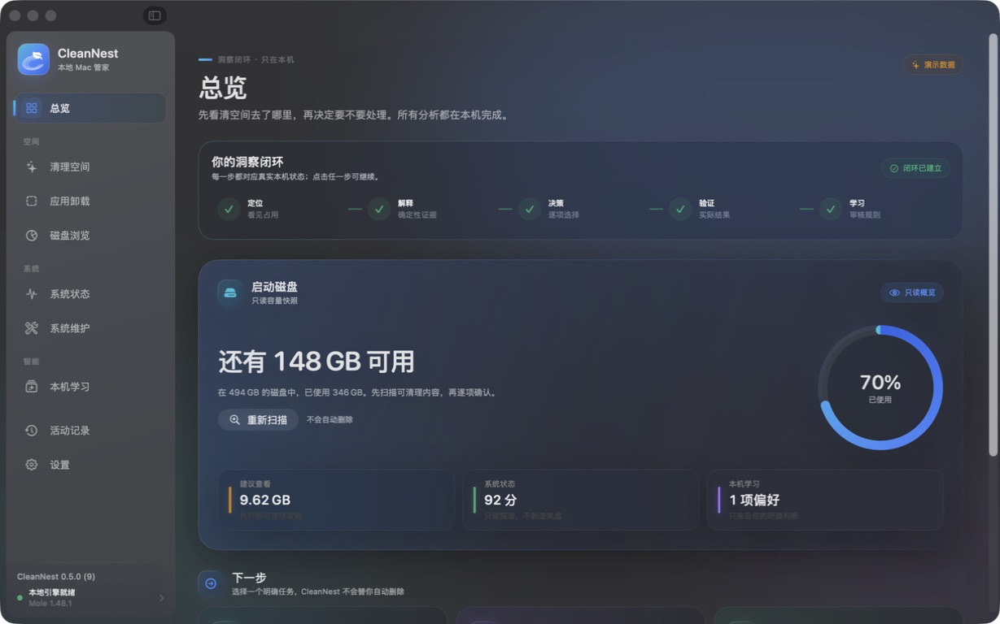

<div align="center">

# CleanNest

**先看清 Mac 空间去了哪里，再安全释放真正可回收的部分。**

原生 macOS 图形客户端，整合 Mole 与可选的本机 MLX/Gemma。核心扫描与模型分析留在 Mac 上，文件默认移入废纸篓。

**简体中文** · [English](README.en.md) · [繁體中文](README.zh-TW.md) · [日本語](README.ja.md) · [한국어](README.ko.md)

[](https://github.com/n9896027/CleanNest/actions/workflows/ci.yml)
[](https://github.com/n9896027/CleanNest/actions/workflows/codeql.yml)


[](LICENSE)

[文档](#文档导航) · [查看发布页](https://github.com/n9896027/CleanNest/releases) · [报告问题](https://github.com/n9896027/CleanNest/issues) · [安全报告](SECURITY.md)

</div>



CleanNest 希望把“清理 Mac”从一个黑盒按钮变成可理解、可撤销的过程：先告诉你空间去了哪里、目录通常属于什么，再由你决定是否处理。它不是“一键加速器”，也不会因为模型给出建议就自动删除文件。

| 看见 | 理解 | 安全处理 |
| --- | --- | --- |
| 浏览目录、缓存、应用和系统状态 | 用确定性规则解释用途，可选本机 AI 补充上下文 | 逐项预览与确认，文件默认进入废纸篓 |

> [!IMPORTANT]
> 当前项目以源码开放，尚未提供 Developer ID 签名并经 Apple 公证的官方安装包。仓库里的 CI 构建用于验证，不代表可公开分发的可信二进制。

## 为什么使用 CleanNest

| 你遇到的问题 | CleanNest 的处理方式 |
| --- | --- |
| 磁盘空间突然不足，却不知道是什么占满了 | 按目录和文件大小浏览，并用中文解释常见目录用途 |
| 缓存、下载文件和真实个人数据混在一起 | 区分可重建缓存、需复核项目与应保留内容 |
| 活动监视器信息太技术化 | 展示内存压力、交换空间和高占用进程，并解释关闭影响 |
| 卸载 App 后担心残留 | 只预览与 Bundle ID 精确匹配的相关文件 |
| 不想把文件清单发到云端 | 可选使用本机 MLX/Gemma，仅分析受限元数据 |

## 核心能力

- **清理空间**：扫描开发缓存、日志、安装包等候选项，逐项选择后移入 macOS 废纸篓。
- **磁盘浏览**：从文件夹大小出发逐层定位空间占用，并支持本机 AI 解读当前目录构成。
- **系统状态**：显示 CPU、内存、磁盘、电池、温度与健康状态；补充内存压力和进程说明。
- **进程管理**：在身份复核、系统进程保护和二次确认后请求正常退出进程，不自动强制结束。
- **应用卸载**：浏览已安装 App，预览 App 本体及精确匹配的相关文件。
- **系统维护**：按任务运行低风险维护动作，并集中记录结果。
- **Mole 集成**：自动发现 Apple Silicon 或 Intel Homebrew 安装的 `mo`，也可直接在 App 内安装或更新。
- **原生体验**：支持明暗色、自恢复权限引导、活动记录与演示模式。

## 下载与运行

> [!NOTE]
> 当前仓库尚未提供经过 Apple 公证的预编译安装包。日常使用 CleanNest 不需要终端，但现阶段从源码生成 App 仍需运行一次构建命令。后续可下载版本会发布在 [Releases](https://github.com/n9896027/CleanNest/releases)。

系统要求：

- macOS 14 Sonoma 或更高版本
- Xcode Command Line Tools（仅源码构建需要）
- Mole CLI（可选，CleanNest 可在 App 内免费安装）
- Apple Silicon Mac 与 `mlx-lm`（仅本机 AI 功能需要）

从源码构建：

```bash
git clone https://github.com/n9896027/CleanNest.git
cd CleanNest
./build.sh
open build/CleanNest.app
```

构建完成后，后续扫描、分析、清理、维护以及 Mole 安装都可以在 App 内完成。

当前下载状态：仓库暂时只发布源码，尚无 Developer ID 签名与 Apple 公证的二进制安装包。请勿从第三方下载声称由本项目发布的 CleanNest App。

## 本机 MLX / Gemma（可选）

CleanNest 可以连接本机 `mlx_lm.server`，为清理候选和磁盘目录补充用途解释、风险提示与查看顺序。模型不是清理引擎：规则扫描在没有 AI 时仍可正常工作，AI 失败也不会影响已有结果。

隐私和执行边界：

- 只允许显式的 `http://127.0.0.1:<端口>/v1`，不连接局域网或公网模型服务。
- 请求只包含类型、大小、时间、受限 token 和脱敏路径提示等元数据，不读取文件内容。
- 磁盘分析只采样有限数量的子项构成，不发送完整目录树。
- Swift 客户端严格验证模型返回的字段、枚举和项目身份。
- AI 只能显示建议，不能扩大扫描范围、改变勾选、关闭进程或执行删除。

在“设置 → 本机 AI 分析”中选择现有 MLX 模型目录和 `mlx_lm.server`。CleanNest 会优先复用已经运行的回环服务，也可以在 App 内启动服务；应用不会自动下载大型模型。

## 安全设计

- 不允许把 `/System`、`/Library`、用户主目录或允许范围的根目录作为清理目标。
- 原生清理只接受经过白名单校验的后代路径，并拒绝符号链接。
- 文件默认移入 macOS 废纸篓，不使用不可恢复的 `rm -rf`。
- 系统级 App 的卸载可能需要管理员授权；当前版本会明确报错，不绕过权限。
- Mole 的高风险交互命令不会通过模拟键盘自动确认。
- 每个拉取请求运行核心自检、完整 App Bundle 构建和 CodeQL 静态分析。
- GitHub Actions 使用最小权限，依赖与 Action 更新由 Dependabot 检查。

完整披露范围和报告方式见 [SECURITY.md](SECURITY.md)。

## 文档导航

| 文档 | 内容 |
| --- | --- |
| [权限说明](docs/PERMISSIONS.md) | 完全磁盘访问、文件夹授权与签名身份为什么会影响权限 |
| [本机 AI](docs/LOCAL_AI.md) | MLX/Gemma 配置、发送的数据及模型安全边界 |
| [故障排查](docs/TROUBLESHOOTING.md) | Mole、权限、AI、构建和电池状态常见问题 |
| [架构](docs/ARCHITECTURE.md) | 模块、数据流与高风险操作边界 |
| [隐私](PRIVACY.md) | 本机保存的数据、网络访问及清除方式 |
| [路线图](ROADMAP.md) | 已完成、近期计划与暂不承诺事项 |
| [更新记录](CHANGELOG.md) | 版本变化与未发布工作 |
| [参与贡献](CONTRIBUTING.md) | 开发、测试、PR 与安全约束 |

## CleanNest 与 Mole

CleanNest 是独立开发的图形客户端，不是 Mole 官方 App，也不捆绑 Mole 二进制。它通过独立本地进程调用用户自行安装的 CLI，并在设置页保留来源署名。

[Mole](https://github.com/tw93/Mole) 由 tw93 与贡献者维护，采用 GPL-3.0。CleanNest 自身源码采用 [MIT License](LICENSE)。

## 开发与验证

开发期直接运行：

```bash
swift run CleanNest
```

运行核心自检：

```bash
swift test
swift run CleanNestSelfTest
```

使用不接触真实文件的演示数据检查界面：

```bash
CLEANNEST_DEMO=1 swift run CleanNest
```

项目当前版本为 **0.3.1（Build 7）**。CI 会在 Apple Silicon 与 Intel runner 上编译并运行测试。欢迎通过 [Issues](https://github.com/n9896027/CleanNest/issues) 提交可复现的问题或功能建议；安全问题请使用私密漏洞报告渠道。

当前 App 界面及详细维护文档主要使用简体中文；English、繁體中文、日本語和한국어 README 用于帮助更多用户了解项目范围。界面本地化仍在路线图中。
