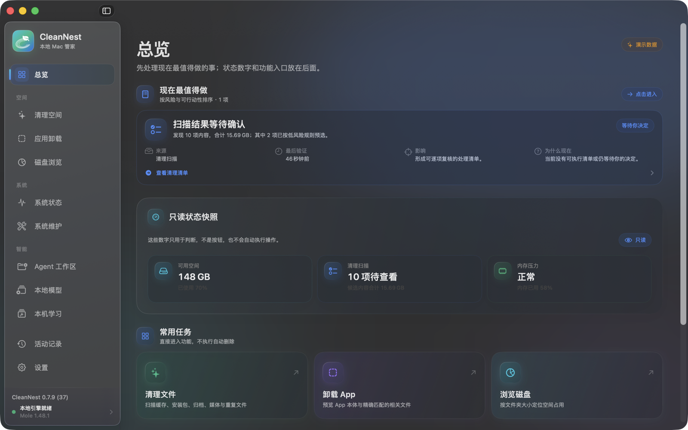
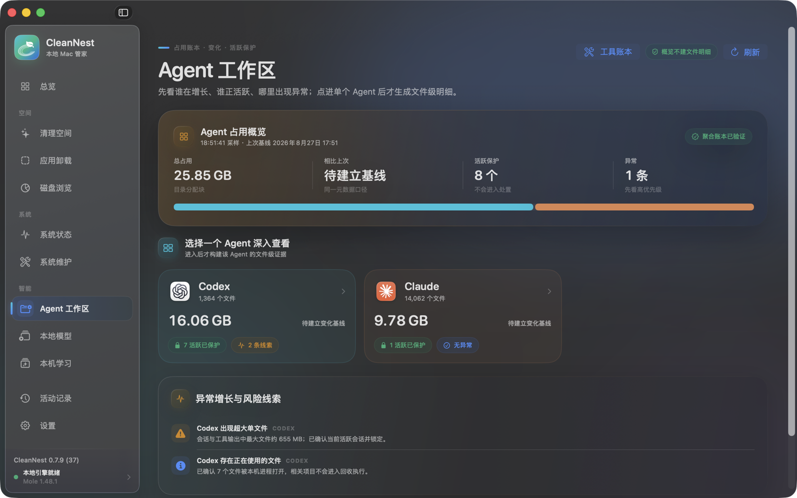
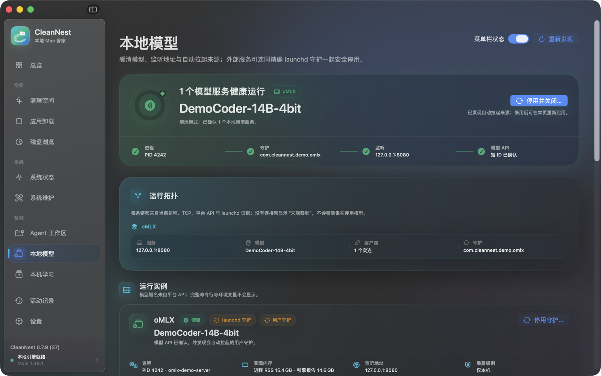
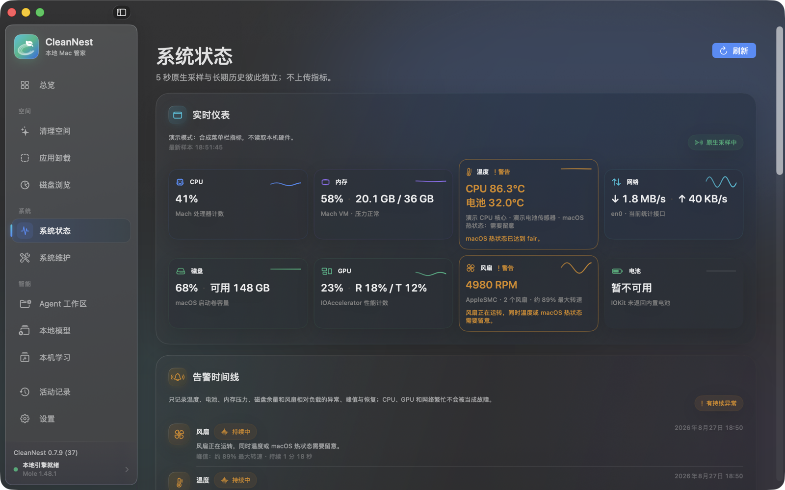
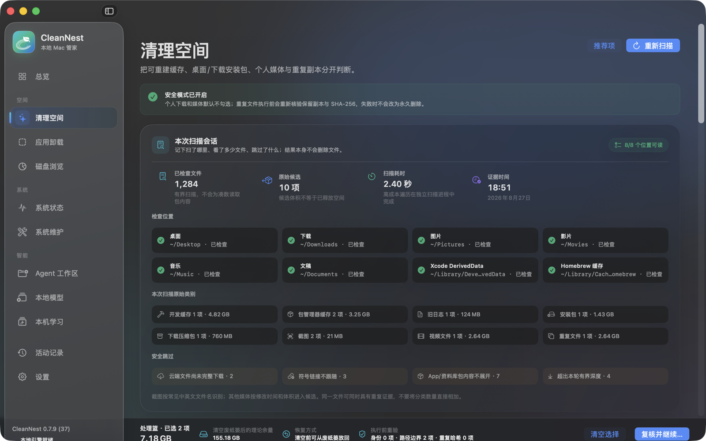

<div align="center">

# CleanNest

**為 AI 開發工作流程打造的本機 Mac 管理與安全清理。**

把 Agent 工作區、本機模型服務、系統告警與磁碟占用放進同一份裝置端證據鏈。先看見、再理解、最後由你決定；檔案預設移到垃圾桶，AI 永遠不能替你授權刪除。

[简体中文](README.md) · [English](README.en.md) · **繁體中文** · [日本語](README.ja.md) · [한국어](README.ko.md)

[](https://github.com/n9896027/CleanNest/actions/workflows/ci.yml)
[](https://github.com/n9896027/CleanNest/actions/workflows/codeql.yml)


[](LICENSE)

[文件](#文件導覽) · [版本發佈](https://github.com/n9896027/CleanNest/releases) · [回報問題](https://github.com/n9896027/CleanNest/issues) · [安全回報](SECURITY.md)

</div>



<p align="center"><sub>合成演示資料 · 真實本機 App 介面 · 不含使用者檔案、真實程序或私人模型資訊</sub></p>

CleanNest 不是替傳統清理器加上一層 AI 文案。它為同時使用 Codex、Claude、Pi Agent、本機模型與開發工具的 Mac 而設計：辨認誰正在增長、什麼仍在執行、服務為何自動重啟、哪些訊號已異常，以及哪些內容能以可復原方式處理。

| Agent 工作區 | 本機模型執行中心 | 狀態與告警 | 安全清理 |
| --- | --- | --- | --- |
| 占用、變化、活躍保護、異常線索 | 平台、短 ID、監聽、客戶端、launchd | CPU、記憶體、網路、GPU、溫度、風扇、電池 | 預覽、身分複核、垃圾桶與復原記錄 |

> [!IMPORTANT]
> CleanNest 現已能在本機建置具 Developer ID 簽署、Apple 公證與票據裝訂的 Universal 2 PKG。實際公開下載以 [Releases](https://github.com/n9896027/CleanNest/releases) 為準；CI 的 ad-hoc 產物仍只用於驗證，不是正式安裝檔。

## 不只是清理器

<table>
  <tr>
    <td width="50%">
      
      <br><strong>Agent 工作區</strong><br>
      <sub>為 Codex、Claude、Pi Agent、Kimi、WorkBuddy、Hermes、OpenClaw、Trae 與 MiniMax Hub 建立有界帳本；只有進入單一 Agent 詳情後才按需建立檔案層級證據。</sub>
    </td>
    <td width="50%">
      
      <br><strong>本機模型執行中心</strong><br>
      <sub>發現 oMLX、MLX-LM、MLX Serve、Ollama、LM Studio 與 llama.cpp/OpenAI-compatible 服務，並解釋連接埠、模型短 ID、TCP 客戶端及自動重啟來源。</sub>
    </td>
  </tr>
  <tr>
    <td width="50%">
      
      <br><strong>裝置端狀態與告警</strong><br>
      <sub>同一套門檻驅動選單列、狀態頁與告警時間線；以文字、符號及顏色顯示異常，不把一般繁忙負載直接判定為故障。</sub>
    </td>
    <td width="50%">
      
      <br><strong>以證據為先的安全清理</strong><br>
      <sub>分開可重建快取、安裝檔、截圖、個人媒體與完整 SHA-256 重複副本；個人檔案不預選，執行前再次複核身分。</sub>
    </td>
  </tr>
</table>

> 上述畫面來自本機 `CLEANNEST_DEMO=1` 執行環境，只證明目前 UI 結構與狀態表達；所有數值、檔案、程序與模型均為合成演示資料，不是使用者實測結果。

## 從問題到可複核結果

| 你遇到的問題 | CleanNest 的處理方式 |
| --- | --- |
| 多個程式 Agent 越用越大，卻不知道誰在增長 | 按 Agent 顯示占用、相對變化、活躍檔案保護與異常線索；檔案證據只在單體詳情內建立 |
| 本機模型停止後又自動啟動 | 先關聯程序、監聽、平台 API、實連客戶端與 launchd 守護，再依擁有權提供分級控制 |
| 溫度或風扇行為異常 | 選單列、狀態頁與有界本機時間線共用門檻，顯示峰值、持續時間與恢復證據 |
| 磁碟突然滿了，卻不知道被什麼占用 | 以目錄、所屬軟體、功能類型三種視角對帳，並分開 APFS 容量、已分類檔案與清理候選 |
| 可重建快取、下載內容與個人資料混在一起 | 區分低風險產生資料、需要檢查的項目與應保留內容 |
| 解除安裝 App 後擔心殘留 | 預覽 App 本體及以精確 Bundle ID 配對的相關檔案 |
| 不想把檔案清單傳給雲端模型 | 確定性掃描不需要 AI；可選分析只接受明確的 `127.0.0.1` 端點與有界中繼資料快照 |

## 核心能力

- **空間清理**：掃描開發快取、記錄檔、安裝檔等候選項目，逐項選擇後移入 macOS 垃圾桶。
- **桌面與掛載安裝媒體**：桌面及下載目錄中的 DMG、PKG、XIP、ISO 與安裝器 ZIP 會進入人工複核；已掛載的安裝映像會單獨顯示來源及安全推出入口，`/Volumes` 內容絕不會進入刪除清單。
- **獨立掃描隔離**：清理、磁碟容量與證據建立由內嵌且獨立簽章的 XPC 服務執行。取消、中斷或掃描器異常不會拖垮主介面，也不會用半成品取代上一次完整結果。
- **Agent 工作區**：為 Codex、Claude、Pi Agent、Kimi、WorkBuddy、Hermes、OpenClaw、Trae 與 MiniMax Hub 建立有界帳本；小雲雀沒有可靠樣本時維持待驗證，不猜測路徑。已安裝 Agent 直接使用本機 App Bundle 的真實圖示；純 CLI 或未安裝項目使用中性替代，CleanNest 不重新散布第三方圖示。0.6.4 會呈現應用程式、資料、程序、launchd、連接埠與本機模型的證據關係，只有已建立 TCP 連線才標示模型實連。安全處置仍硬性限制於 Codex/Claude 的靜置快取、暫存檔與日誌，其他 Agent、會話、索引、記憶、憑證與執行時維持唯讀。
- **開發工具原生帳本**：使用 Git、Docker、Hugging Face、npm 與 pip 的官方檢視介面；只有具備 dry-run 的 Git 與 Hugging Face 會在再次預演後開放確認執行。
- **下載、截圖、媒體與精確重複檔案**：常見 `ScreenShot`、`Screenshot`、`Screen Shot`、`ScreenCapture`、截屏及截圖檔名會直接進入獨立分組，可一鍵全選或取消全選；其他媒體仍按大小與時間篩選，重複內容以完整 SHA-256 確認。個人檔案不會預先勾選，執行前會再次核對檔案身分與保留副本。
- **增量磁碟瀏覽**：掃描時持續顯示部分結果；15 分鐘內只重用中繼資料簽章未變的項目，並明確顯示快取命中、實際掃描與深度重新整理。
- **清理決策中心**：除 Treemap 與麵包屑外，逐項說明用途、變大原因、處理影響、可恢復性、證據強度與安全下一步；你可手動標記待複核、保留或稍後處理，但不能覆蓋安全邊界。
- **選單列即時監測**：可以 1/2/5/10 秒取樣 CPU、記憶體、網路、磁碟、GPU、溫度、風扇與電池；預設用 State 式雙層短標籤節省寬度，並可調整順序、顯示方式與網卡口徑。警告與嚴重狀態會同時使用橙／紅色及 `!`／`!!`，並結合 macOS 熱狀態與實際壓力訊號，不把一般高負載誤報為故障。
- **本機模型執行中心**：交叉檢查處理程序、偵聽連接埠、平台 API 與 launchd 守護，顯示模型短名、PID、記憶體、暴露狀態及 `KeepAlive`／登入啟動證據；外部服務可在風險確認後連同精確使用者守護一起停用並關閉，設定保留且可重新啟用。
- **系統狀態**：顯示 CPU、記憶體、磁碟、電池、溫度與健康狀態，每 60 秒在本機保存趨勢。
- **程序管理**：通過身分複核、系統程序保護及使用者確認後，才請求程序正常結束；不會自動強制結束。
- **應用程式解除安裝**：瀏覽已安裝 App，預覽 App 本體及以精確 Bundle ID 配對的相關檔案。
- **系統維護**：按項目執行低風險維護工作，並集中保留執行結果。
- **可審核本機學習**：明確選擇或成功清理只建立待審核提案；必須由你啟用，之後也可暫停、恢復或撤銷。
- **模型工作台**：用不含檔案中繼資料的最小請求實測健康延遲、首字回應、總耗時、實際 API 模型短名與記憶體餘量。
- **資料控制**：活動記錄可匯出 JSON 或單獨清除；恢復安全預設值不會混同清除學習、索引、歷史指標或 macOS 權限。
- **內建原生引擎**：清理、磁碟、系統資料、Agent 和系統狀態均無需 Homebrew 或額外清理引擎。
- **檢查更新**：可從 App 選單或「關於」頁主動查詢 GitHub 最新正式 Release；只比較版本並開啟經倉庫驗證的發布頁，不會靜默下載或安裝。
- **原生體驗**：SwiftUI/AppKit 介面、明暗模式、權限恢復引導、活動記錄與安全展示模式。
- **唯讀 MCP**：透過 App 內建的 stdio 程序提供有界、脫敏的本機證據；沒有 HTTP、刪除、程序控制或設定工具。
- **三語資源**：核心導覽與主要頁面以 String Catalog 提供 English、简体中文與繁體中文。

## 下載與執行

系統需求：

- macOS 14 Sonoma 或更新版本
- Xcode Command Line Tools，只有從原始碼建置時需要
- Apple Silicon 與 `mlx-lm`，只有可選的本機 AI 需要

從原始碼建置：

```bash
git clone https://github.com/n9896027/CleanNest.git
cd CleanNest
./build.sh
open build/CleanNest.app
```

完成一次原始碼建置後，日常掃描、分析、清理和維護都可在圖形介面內進行，無需安裝額外引擎。

正式 PKG 使用 Developer ID Application / Installer 簽署、Apple 公證與票據裝訂；維護者可用 `scripts/build-installer.sh` 建置 Universal 2 安裝檔。公開下載以 Releases 為準，並應核對版本、SHA-256 與已知限制。CI 的 ad-hoc 成品仍只用於驗證。從舊自簽名副本升級後，若 macOS 提示權限失效，請重新授權目前的 `/Applications/CleanNest.app`。

## 可替換的本機 MLX 模型（可選）

CleanNest 可以連接本機 `mlx_lm.server`，為清理候選與磁碟目錄補充用途說明、風險提示和檢查順序。模型只是解釋層，不是清理引擎；關閉 AI 後，確定性掃描與安全規則仍可運作。

隱私與執行邊界：

- 只接受明確的 `http://127.0.0.1:<連接埠>/v1`；拒絕區域網路與公網模型端點。
- 請求只包含類型、大小、時間、一次性 token 和脫敏路徑提示等有限中繼資料，不包含檔案內容。
- 磁碟解讀只使用有限的直接子項目樣本，不傳送完整目錄樹。
- Swift 用戶端嚴格驗證欄位、列舉值、回應大小與項目身分。
- AI 不能擴大掃描、勾選項目、結束程序、執行指令或刪除檔案。

在「设置 → 本机 AI 分析」中，CleanNest 可重用 oMLX 等既有回環服務，或啟動所選的 `mlx_lm.server`。App 會從 `/v1/models` 讀取實際 API 模型短名，並把它與自啟所需的本機目錄分開，避免把檔案路徑誤傳給 oMLX。掃描範圍包含 `~/.omlx/models`；App 不會自動下載大型模型、修改 DFlash 設定或代替使用者接受模型條款。

## 安全設計

- `/System`、`/Library`、使用者主目錄、系統根目錄或允許範圍的根目錄本身不能成為清理目標。
- 原生清理只接受經白名單驗證的後代路徑，並拒絕符號連結。
- 檔案預設移入 macOS 垃圾桶，不使用不可復原的 `rm -rf` 清理路徑。
- 解除安裝系統層級 App 可能需要管理員授權；目前版本會明確回報限制，不會繞過權限。
- 任何高風險互動命令都不會透過模擬鍵盤自動確認。
- 每個 Pull Request 都執行核心測試、完整 App Bundle 建置、架構檢查、依賴審查與 CodeQL。
- GitHub Actions 採最小權限及不可變 Action 參照；Dependabot 檢查依賴與 Action 更新。

完整揭露範圍與私密回報方式請見 [SECURITY.md](SECURITY.md)。

## 文件導覽

詳細維護文件目前主要使用簡體中文：

| 文件 | 內容 |
| --- | --- |
| [權限說明](docs/PERMISSIONS.md) | 完全磁碟存取、資料夾授權及程式碼身分為何影響 macOS 權限 |
| [本機 AI](docs/LOCAL_AI.md) | MLX 模型選擇、切換、傳送的中繼資料及安全邊界 |
| [疑難排解](docs/TROUBLESHOOTING.md) | 內建引擎、權限、AI、建置、程序與電池狀態問題 |
| [架構](docs/ARCHITECTURE.md) | 模組、資料流與高風險操作邊界 |
| [隱私](PRIVACY.md) | 本機資料、網路存取、保留與清除方式 |
| [路線圖](ROADMAP.md) | 已完成內容、近期優先順序及明確不承諾事項 |
| [更新記錄](CHANGELOG.md) | 已發佈與尚未發佈的變更 |
| [參與貢獻](CONTRIBUTING.md) | 開發、測試、Pull Request 與安全要求 |

## 內建原生引擎

CleanNest 的清理、磁碟、系統資料、Agent 和系統狀態全部由隨 App 安裝的原生元件完成，不偵測、呼叫或安裝外部清理引擎。Homebrew 只作為開發快取掃描對象，不是執行依賴。

CleanNest 自身原始碼採用 [MIT License](LICENSE)。MLX 與使用者所選模型資訊請見[第三方專案說明](THIRD_PARTY_NOTICES.md)。

## 開發與驗證

```bash
swift run CleanNest
swift test
swift run CleanNestSelfTest
```

使用純展示資料檢查介面：

```bash
CLEANNEST_DEMO=1 swift run CleanNest
```

目前版本為 **0.12.0（Build 50）**，重點是清理前活躍檔案複核、逐路徑复核、執行帳本、單項復原與可信發佈。正式 PKG 必須從通過檢查的乾淨 `main` 提交建置，實際公開下載仍以 Releases 為準。真實 48 小時、完整三語人工 UI、Intel 真機與 0.12.0 乾淨 Mac 實裝必須分別留下證據，不能以 CI 編譯或舊版本公證代替。歡迎透過 [Issues](https://github.com/n9896027/CleanNest/issues) 提交可重現問題或功能建議；安全漏洞請私密回報。

目前 App 介面與詳細維護文件仍以簡體中文為主。本繁體中文 README 用於正確說明專案範圍，不代表介面本地化已完成。
