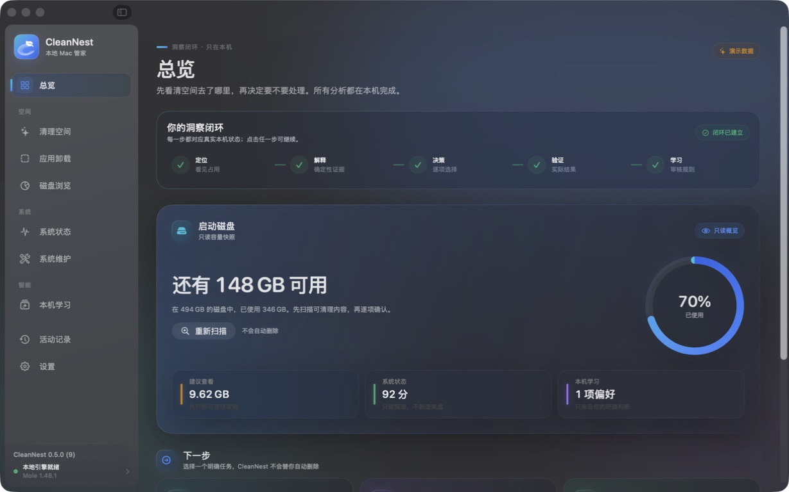

<div align="center">

# CleanNest

**先看清 Mac 空間去了哪裡，再安全釋放真正可回收的部分。**

原生 macOS 圖形應用程式，整合 Mole 與可選的本機 MLX/Gemma。核心掃描與模型分析留在 Mac 上，檔案預設移到垃圾桶。

[简体中文](README.md) · [English](README.en.md) · **繁體中文** · [日本語](README.ja.md) · [한국어](README.ko.md)

[](https://github.com/n9896027/CleanNest/actions/workflows/ci.yml)
[](https://github.com/n9896027/CleanNest/actions/workflows/codeql.yml)


[](LICENSE)

[文件](#文件導覽) · [版本發佈](https://github.com/n9896027/CleanNest/releases) · [回報問題](https://github.com/n9896027/CleanNest/issues) · [安全回報](SECURITY.md)

</div>



CleanNest 希望把「清理 Mac」從黑盒按鈕變成可理解、可復原的流程：先說明空間用在哪裡、目錄通常屬於什麼，再由你決定是否處理。它不是「一鍵加速器」，模型建議也永遠不能自行刪除檔案。

| 看見 | 理解 | 安全處理 |
| --- | --- | --- |
| 瀏覽目錄、快取、應用程式與系統狀態 | 由確定性規則說明用途，可選本機 AI 補充情境 | 逐項預覽與確認，檔案預設進入垃圾桶 |

> [!IMPORTANT]
> CleanNest 目前只以原始碼形式提供，尚無使用 Developer ID 簽署並通過 Apple 公證的官方下載。CI 建置用於驗證專案，不是可公開散佈的可信二進位檔。

## 為什麼使用 CleanNest

| 你遇到的問題 | CleanNest 的處理方式 |
| --- | --- |
| 磁碟突然滿了，卻不知道被什麼占用 | 按資料夾與檔案大小逐層瀏覽，並解釋常見 macOS 目錄用途 |
| 可重建快取、下載內容與個人資料混在一起 | 區分低風險產生資料、需要檢查的項目與應保留內容 |
| 活動監視器資訊太技術化 | 說明記憶體壓力、交換空間與高用量程序，讓你先理解再決定是否結束 |
| 解除安裝 App 後擔心殘留 | 預覽 App 本體及以精確 Bundle ID 配對的相關檔案 |
| 不想把檔案清單傳給雲端模型 | 可選用本機 MLX/Gemma，只分析受限制且已脫敏的中繼資料 |

## 核心能力

- **空間清理**：掃描開發快取、記錄檔、安裝檔等候選項目，逐項選擇後移入 macOS 垃圾桶。
- **磁碟瀏覽**：從資料夾大小逐層找出空間占用，並可選用本機 AI 解讀目前目錄構成。
- **系統狀態**：顯示 CPU、記憶體、磁碟、電池、溫度與健康狀態，並補充記憶體壓力與程序說明。
- **程序管理**：通過身分複核、系統程序保護及使用者確認後，才請求程序正常結束；不會自動強制結束。
- **應用程式解除安裝**：瀏覽已安裝 App，預覽 App 本體及以精確 Bundle ID 配對的相關檔案。
- **系統維護**：按項目執行低風險維護工作，並集中保留執行結果。
- **Mole 整合**：自動尋找 Apple Silicon 或 Intel Homebrew 安裝的 `mo`，也可從 App 內安裝或更新 Mole。
- **原生體驗**：SwiftUI/AppKit 介面、明暗模式、權限恢復引導、活動記錄與安全展示模式。

## 下載與執行

系統需求：

- macOS 14 Sonoma 或更新版本
- Xcode Command Line Tools，只有從原始碼建置時需要
- Mole CLI，可選；CleanNest 可透過 App 內的 Homebrew 流程安裝
- Apple Silicon 與 `mlx-lm`，只有可選的本機 AI 需要

從原始碼建置：

```bash
git clone https://github.com/n9896027/CleanNest.git
cd CleanNest
./build.sh
open build/CleanNest.app
```

完成一次原始碼建置後，日常掃描、分析、清理、維護和 Mole 安裝都可在圖形介面內進行。

目前倉庫只發佈原始碼。請勿信任第三方聲稱是 CleanNest 官方版本的下載。

## 本機 MLX / Gemma（可選）

CleanNest 可以連接本機 `mlx_lm.server`，為清理候選與磁碟目錄補充用途說明、風險提示和檢查順序。模型只是解釋層，不是清理引擎；關閉 AI 後，確定性掃描與安全規則仍可運作。

隱私與執行邊界：

- 只接受明確的 `http://127.0.0.1:<連接埠>/v1`；拒絕區域網路與公網模型端點。
- 請求只包含類型、大小、時間、一次性 token 和脫敏路徑提示等有限中繼資料，不包含檔案內容。
- 磁碟解讀只使用有限的直接子項目樣本，不傳送完整目錄樹。
- Swift 用戶端嚴格驗證欄位、列舉值、回應大小與項目身分。
- AI 不能擴大掃描、勾選項目、結束程序、執行指令或刪除檔案。

在目前的簡體中文介面開啟「设置 → 本机 AI 分析」，選擇既有的 MLX 模型目錄與 `mlx_lm.server`。CleanNest 可重用相容的回環服務或啟動所選本機服務；不會自動下載大型模型，也不會代替使用者接受模型條款。

## 安全設計

- `/System`、`/Library`、使用者主目錄、系統根目錄或允許範圍的根目錄本身不能成為清理目標。
- 原生清理只接受經白名單驗證的後代路徑，並拒絕符號連結。
- 檔案預設移入 macOS 垃圾桶，不使用不可復原的 `rm -rf` 清理路徑。
- 解除安裝系統層級 App 可能需要管理員授權；目前版本會明確回報限制，不會繞過權限。
- Mole 的高風險互動命令不會透過模擬鍵盤自動確認。
- 每個 Pull Request 都執行核心測試、完整 App Bundle 建置、架構檢查、依賴審查與 CodeQL。
- GitHub Actions 採最小權限及不可變 Action 參照；Dependabot 檢查依賴與 Action 更新。

完整揭露範圍與私密回報方式請見 [SECURITY.md](SECURITY.md)。

## 文件導覽

詳細維護文件目前主要使用簡體中文：

| 文件 | 內容 |
| --- | --- |
| [權限說明](docs/PERMISSIONS.md) | 完全磁碟存取、資料夾授權及程式碼身分為何影響 macOS 權限 |
| [本機 AI](docs/LOCAL_AI.md) | MLX/Gemma 設定、傳送的中繼資料及模型安全邊界 |
| [疑難排解](docs/TROUBLESHOOTING.md) | Mole、權限、AI、建置、程序與電池狀態問題 |
| [架構](docs/ARCHITECTURE.md) | 模組、資料流與高風險操作邊界 |
| [隱私](PRIVACY.md) | 本機資料、網路存取、保留與清除方式 |
| [路線圖](ROADMAP.md) | 已完成內容、近期優先順序及明確不承諾事項 |
| [更新記錄](CHANGELOG.md) | 已發佈與尚未發佈的變更 |
| [參與貢獻](CONTRIBUTING.md) | 開發、測試、Pull Request 與安全要求 |

## CleanNest 與 Mole

CleanNest 是獨立開發的圖形用戶端，不是 Mole 官方 App，也不捆綁 Mole 二進位檔。它以獨立本機程序呼叫使用者另外安裝的 CLI，並在設定中保留來源標示。

[Mole](https://github.com/tw93/Mole) 由 tw93 與貢獻者維護，採用 GPL-3.0。CleanNest 自身原始碼採用 [MIT License](LICENSE)。MLX 與 Gemma 資訊請見[第三方專案說明](THIRD_PARTY_NOTICES.md)。

## 開發與驗證

```bash
swift run CleanNest
swift test
swift run CleanNestSelfTest
```

使用純展示資料檢查介面：

```bash
CLEANNEST_DEMO=1 swift run CleanNest
```

目前專案版本為 **0.3.1（Build 7）**。CI 會在 Apple Silicon 與 Intel runner 上建置並執行測試。歡迎透過 [Issues](https://github.com/n9896027/CleanNest/issues) 提交可重現問題或功能建議；安全漏洞請私密回報。

目前 App 介面與詳細維護文件仍以簡體中文為主。本繁體中文 README 用於正確說明專案範圍，不代表介面本地化已完成。
